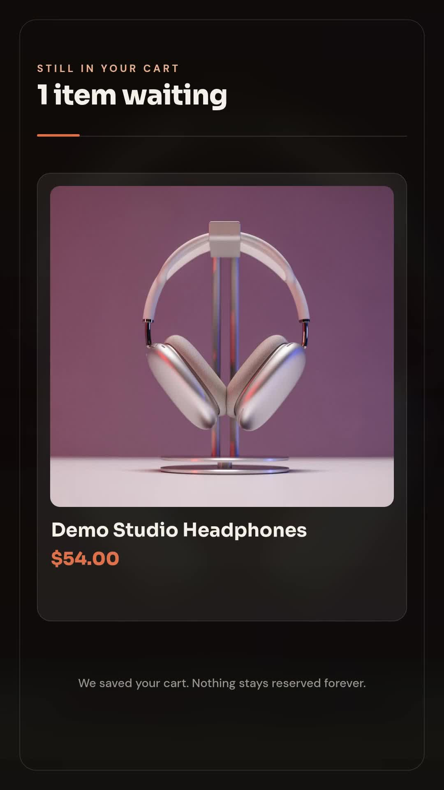

# Abandoned-cart personalized product video

Turn the first pending cart in sheet-shaped JSON into a personalized vertical MP4 using the same cart picker and video builder as the n8n workflow. The supplied fictional example greets Alex and shows Demo Studio Headphones at $54.00.

[](assets/sample-output.mp4)

The retained sample is 1080 × 1920, 13.8 seconds, with music. Its recorded validation quote was 14 credits, not an independently audited billing total. It was rendered in the earlier live tutorial. The current config uses slightly revised punctuation and CDN-hosted source media; the visual design and cart mapping are unchanged. Current offline tests are not a fresh live render.

## Requirements

- Node.js 22 or newer and npm.
- A Zvid API key from https://app.zvid.io/api-keys for validation or rendering.
- Render credits when you choose to create an MP4. Validation does not reserve or consume render credits.

## Install and check locally

Run from this folder:

```bash
npm ci
npm run check
npm test
npm run offline
```

PowerShell users can use `npm.cmd` if local script execution policy blocks `npm`. Offline creates `out/offline/project.json`; it does not call Zvid or download media. Tests use mocked API responses to cover validation failure, credit ceilings, saved receipts, polling recovery, empty rows, missing photos and unreadable prices.

## Preview and render

Copy `.env.example` to `.env` and enter your own `ZVID_API_KEY`. Never publish that file. The API base is https://api.zvid.io.

```bash
npm run dry-run
npm run sample -- --max-credits 20
```

The dry run validates `data/cart.json` and writes `out/preview/result.json`, including `creditsQuoted`. It does not create an editor draft. The sample command submits once only if the quote is at or below the ceiling and then polls for completion. `config.json` ships with `dryRun: false`; the explicit ceiling is also required for a render. No email is sent.

Private outputs:

- `project.json`: complete render payload.
- `result.json`: state, selected cart metadata, quote, saved job ID and final `videoUrl` after completion. Open that URL to watch and save the MP4.

The script accepts an array of objects using the Google Sheets column names in `data/cart.json`. It selects the first nonblank row with an empty `Status`. Each execution handles one cart, with up to three titled product lines. The spreadsheet export's `row_number` is retained for your own reconciliation.

```bash
npm start -- --input data/my-carts.json --out out/my-cart --max-credits 20
```

The companion does not connect to Google Sheets, update rows, poll Shopify, send SMTP mail or schedule itself. Those connected steps belong to the n8n route. Your application owns queue eligibility, purchase checks and marking a cart processed after success. A processed cart is not proof of a recovered purchase.

## Resume without another paid submission

```bash
npm start -- --resume --out out/sample
```

Use the same output directory. Resume polls the saved job; it never calls render creation. A timeout means this client stopped waiting, not necessarily that the job failed. If the saved state is `submission-pending` without a job ID, inspect your Zvid dashboard before another attempt because the outcome may be unknown. The SDK's creation retries are disabled.

The program refuses to overwrite a saved run and locks its output folder during execution. It does not deduplicate across separate output folders or machines. After an offline or dry-run output, choose a separate folder for the paid run as the supplied npm commands do.

## n8n

Import [n8n/workflow.json](n8n/workflow.json). Install **`@zvid/n8n-nodes-zvid`** from **Settings → Community nodes** before creating credentials; a workspace owner/admin may need to install it. Keep the schedule inactive during setup. Follow [n8n/README.md](n8n/README.md).

The screenshot is an authentic earlier canvas. Its HTTP-based Zvid nodes and old note placement differ from the maintained native-node export. Follow the JSON and current instructions for node configuration.

## Limits and maintenance

- Missing/non-HTTP images become numbered tiles; a remote HTTP image can still fail if unavailable. Keep source dimensions within account limits.
- A missing or oversized music asset is skipped after a HEAD check. Offline builds omit music because no network check runs.
- The total is suppressed when a price cannot be parsed. Verify pricing and any urgency language before sending a video.
- First names and cart details appear in the public-facing video. Keep customer files and result logs private and apply your own retention policy.
- Output availability depends on your Zvid plan. Download or copy media to storage you control before it expires.
- The supplied checkout link and brand are fictional. Replace them before delivery.

The general [Zvid automation video](https://youtu.be/i22Yzjlq9Tg) introduces template-based video creation; it is not a recording of this exact cart workflow. See `links.json` for publication destinations. Help: https://zvid.io/contact.
