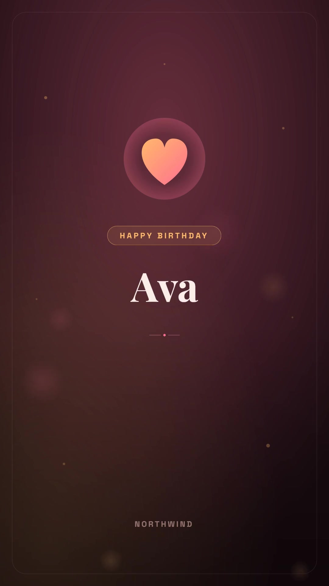

# Birthday and anniversary greeting videos

Create one private, branded greeting for a due birthday or anniversary with confirmed consent. The n8n workflow reads Google Sheets, preserves annual render history, and offers optional approved SMTP delivery. The Node.js companion reads a local JSON export and keeps its recovery journal on disk; it never sends email.

[](assets/sample-output.mp4)

The sample is a fictional birthday for Ava: two scenes, 1080 × 1920, approximately 10.25 seconds, no audio and no displayed age. `config.json` uses the same design as the checked-in n8n workflow, with a reviewed signoff and message. `assets/sample-output.json` records reproduction and verification details. Zvid validation supplies the current credit estimate; rendering spends credits.

## Install and check

Use Node.js 22 or newer. From this folder, or the extracted standalone ZIP:

```sh
npm ci
npm run check
npm test
```

Copy `.env.example` to `.env` and set `ZVID_API_KEY` to the complete API key created at https://app.zvid.io/api-keys. Keep `ZVID_API_URL=https://api.zvid.io`. The checks and tests do not need credentials or submit paid jobs.

## Validate, render and recover

```sh
npm run sample
npm start -- --date 2026-10-29 --max-credits 15
npm start -- --resume
```

`npm run sample` uses the supplied fictional row and its demonstration date, 29 October 2026. It calls validation and writes `out/preview.json` and `out/project.json`. This does not consume render credits, create an editor draft, modify the annual journal or send messages. Inspect the selected name, hidden age, message, warnings and `creditsRequired`.

The second command submits a paid render only if validation succeeds and the quote is within 15 credits. `dryRun` is `false` in `config.json`; plain `npm start` also renders, but selects contacts due on the current date. `--date` is an explicit testing override; omit it for real due-date processing. `--max-credits` overrides the config ceiling for that command, not the account's budget.

The CLI writes submission intent to `out/celebration-runs.json` before submitting, then persists the accepted ID before polling. It saves `out/greeting.mp4` and the completed URL in `out/result.json`. Keep the same output folder for your annual queue so completed keys remain available. A new folder has no previous deduplication history.

`--resume` reads the last saved job ID and polls/downloads it again without another paid submission. Normal runs also prioritize accepted outstanding jobs, even after their event date. A lost submission response remains `needs_review`; inspect your Zvid dashboard before deliberately resetting that specific entry. The SDK has automatic retries disabled. The CLI does not automatically retry HTTP 429 responses; inspect the outcome before retrying. The n8n implementation has a separate bounded retry path for explicit capacity rejections.

Writes use atomic replacement and a process lock in the output folder. If a process is forcibly terminated, confirm it has stopped before removing `.run.lock`. Keep the journal and `result.json`. This lock only coordinates processes using that exact folder; it is not a distributed database lock.

## Input and consent

`data/celebrations.json` is an array of rows with `CelebrationKey`, `Name`, `Type`, `Date`, `Approval` and `GreetingConsent`. Dates are real `YYYY-MM-DD` dates. Assign a permanent unique key per occasion; never use a changing row number. `Type` is `birthday` or `anniversary`. Use `Approval: "approved"` and confirmed `GreetingConsent: true`. `DoNotContact: true` excludes the row. These example rules protect the greeting queue; they are not general Zvid project-schema requirements.

Birthday age is hidden unless `ShowAge` is explicitly true. Anniversaries count completed years and skip year zero. `LastSentYear` protects legacy rows already handled in that year. Birthday and anniversary keys are independent. `leapDayPolicy` is `feb28`, `march1` or `skip`; the supplied default is `feb28`. The configured `timezone` determines today's date.

Use your own curated export with:

```sh
npm start -- --input data/my-celebrations.json --config config.json --out out --max-credits 15
```

The planner selects one eligible greeting and reports deferred/skipped rows. It preserves the original plan with an accepted job. The CLI deliberately has no Google Sheets connection, schedule, SMTP delivery or music fetching; keep `musicUrl` empty and perform private delivery in your own application after checking consent. For these integrations, use the n8n workflow.

## n8n alternative

Follow [n8n setup](n8n/README.md). Install **`@zvid/n8n-nodes-zvid`** from **Settings → Community nodes** before configuring credentials; a workspace owner/admin may need to install it. Select Zvid and Google Sheets credentials on the relevant nodes. Keep the schedule inactive until the consent, preview, render and recovery paths have been checked.

The n8n export is synchronized with the canonical source. To reproduce Ava's sample, use the supplied contact data and `config.json`; align the row's month/day with the execution date. The separate `manualDemo` option creates a different fictional DEMO Ava greeting and intentionally uses a fresh key on each manual execution. It is not the same annual-record example.

## Links

- [Official n8n template](https://n8n.io/workflows/20675-create-consent-aware-birthday-and-anniversary-videos-with-google-sheets-and-zvid/)
- [Zvid validation and estimates](https://docs.zvid.io/docs/validate-and-estimate/)
- [General Zvid walkthrough](https://youtu.be/i22Yzjlq9Tg)
- Help: https://zvid.io/contact
