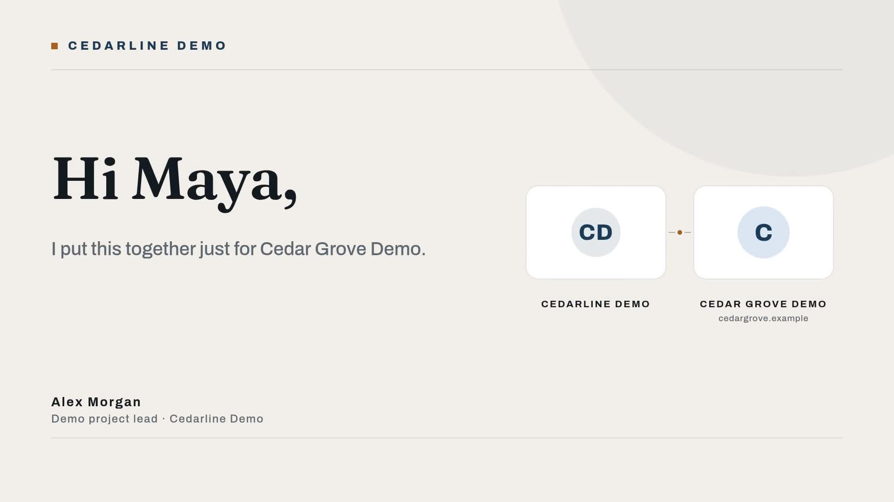

# Personalized cold outreach videos

Create a landscape video for each pending lead, using their name, company and role in the same three-scene design. The sample is fictional: Maya at Cedar Grove Demo, introduced by Alex Morgan at Cedarline Demo. This project does not send email, scrape sites or connect to a CRM.

[](assets/sample-output.mp4)

## Choose n8n or Node.js

The [n8n workflow](n8n/workflow.json) reads Google Sheets and writes `Status` and `VideoUrl` back. Install `@zvid/n8n-nodes-zvid` from **Settings → Community nodes** before configuring Zvid credentials; a workspace owner/admin may need to install it. Follow [n8n setup](n8n/README.md).

The Node.js alternative uses a local JSON queue with the same column names and exact checked-in n8n selection/builder code. It validates every selected lead, submits one bulk request, polls saved job IDs and writes `leads-updated.json`. It does not update Google Sheets, create editor drafts or schedule itself. It uses the official `@zvid/sdk`.

## Setup

Install Node.js 22 or newer. From this folder:

```bash
npm ci
npm run check
npm test
npm run offline
```

The offline commands need no key and spend no credits. They build `out/offline/batch.json`; external logos and music are omitted in offline mode. Copy `.env.example` to `.env` and set `ZVID_API_KEY` to a key created at https://app.zvid.io/api-keys. Keep `.env` private. The API base is https://api.zvid.io.

```bash
npm run dry-run
npm start -- --out out/sample --max-credits 12
```

The preview validates with Zvid and saves resolved `lead-1.json` plus `result.json` in `out/preview`. It does not consume render credits or create an editor draft. The second command renders the supplied fictional row. Configuration ships with `dryRun: false`; normal `npm start` spends render credits. The historical sample was quoted at 12 credits for 11.75 seconds at 1920 × 1080. Check your current quote and budget; rates or modified inputs may differ.

Edit `config.json` for your identity, pitch and meeting URL. Replace every illustrative claim and `.example` domain before real use. Blank logos produce monograms; blank `musicUrl` makes the sample silent. `data/leads.json` contains the exact sample. Keep `row_number` unique and at least 2; this is the example queue's identity rule. Only empty `Status` values are selected.

## Results and recovery

`out/sample/result.json` preserves submission, bulk/job IDs, quotes, completed videos and failures. Open the `videoUrl` in each completed item to watch/download it. `out/sample/leads-updated.json` contains successful rows marked `done` with `VideoUrl`; failed rows remain pending. Review each video before sending its link. The meeting address inside an MP4 is not clickable; place your booking link in the accompanying message.

If waiting fails after acceptance, keep the same directory:

```bash
npm start -- --out out/sample --resume
```

Resume only polls the saved receipt; it does not submit again. If `state` is `submission-pending` with no usable receipt, check https://app.zvid.io before starting another run: the server may have accepted it. An output-directory lock prevents concurrent processes from using that directory. Do not run the same queue concurrently in different directories.

For the next batch, use the updated queue:

```bash
npm start -- --input out/sample/leads-updated.json --out out/next --max-credits 12
```

Persist the updated queue and job receipts before scheduling. The tool does not maintain a cross-run ledger, refresh Google credentials, or deliver outreach. A render timeout does not cancel remote work. Partial failures remain in `result.json`; investigate before choosing whether to retry them.

## Sample and source

`assets/sample-output.mp4`, poster and resolved project come from the historical n8n run with this exact fictional input and configuration. `assets/sample-output.json` records hashes and provenance. Offline tests verify Node.js selection, cost control, completion mapping and recovery. They do not constitute a fresh paid Node.js execution.

Support: https://zvid.io/contact
