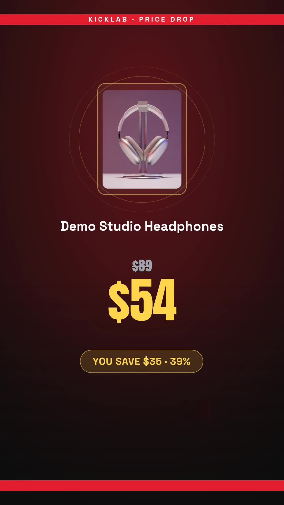

# Flash-sale video and banner from one price drop

Create a 1080 × 1920 sale video and a 1200 × 628 banner from the same approved offer. The fictional sample is Demo Studio Headphones, reduced from $89 to $54: a $35 saving and a 39% displayed discount. The percentage is rounded down.

[Watch the sample](assets/sample-output.mp4) · [View the banner](assets/sample-banner.png)



## Requirements

- Node.js 20.12 or newer.
- A Zvid API key from https://app.zvid.io/api-keys for live validation and rendering.
- An approved offer and a publicly reachable product photo. The included fictional sample already has a Zvid CDN image.

The Node.js example reads one local JSON row. It does not connect to Google Sheets, monitor Shopify, send email, create editor drafts or publish campaigns. The synchronized n8n workflow supplies Google Sheets reading/write-back and an optional SMTP branch. Both use the same checked-in design builder.

## Install and check

Open a terminal in this folder:

```sh
npm ci
npm run check
npm test
npm run offline
```

These commands need no credentials or render credits. `offline` builds the video and banner project payloads in `out/offline/result.json`; it does not render them.

## Validate and render

Copy `.env.example` to `.env`, then set `ZVID_API_KEY` privately. Leave `config.json`'s `musicUrl` empty. Edit `data/sale.json` for another offer, keeping `Status`, `VideoUrl` and `BannerUrl` empty. Prices must be positive, the new price must be lower and the discount must be at least 1%.

```sh
npm run dry-run
npm start -- --max-credits 15
```

The first command calls validation for both projects and reports their combined quote in `out/run/result.json`. Validation does not consume render credits. The second validates again and renders only when the total quote fits the supplied ceiling. The included 13.4-second video and banner previously received a 14 + 1 = 15 credit quote. Check the current quote; credit and account limits can change.

Without `--dry-run`, the script attempts rendering. It requires an explicit `--max-credits` amount before any paid request. A quote is not a reserved balance or a server-enforced billing cap.

The video completes before the banner is submitted. Keep `out/run/result.json`: each accepted job ID is saved before polling. When both complete, this file contains each asset's `url`. Open the video URL to watch and use the browser's download control; open the banner URL and save the image. Download before the output expiry shown by Zvid.

## Recover an interrupted run

```sh
npm start -- --resume --max-credits 15
```

Resume checks the recorded jobs and skips completed assets. A timeout does not cancel a remote render. An uncertain submission is never repeated automatically: check https://app.zvid.io before choosing another output folder. An explicit HTTP 429 rejection is saved as `rejected`; wait at least 30 seconds and any longer server retry delay before resuming. Unlike n8n, this script does not automatically retry submission rejections.

A failed asset stops the pair. Inspect the saved job and reason before deliberately starting a new run with `--out out/new-offer`. A new output folder is a new paid attempt, not recovery. After a process crash, a `.run.lock` may remain; first confirm no process is using that output folder, then remove only that lock before resuming.

## n8n alternative

Follow [n8n setup](n8n/README.md). Install `@zvid/n8n-nodes-zvid` from **Settings → Community nodes** before configuring Zvid credentials. A workspace owner/admin may need to install it. Import `n8n/workflow.json`.

The n8n download preserves `dryRun: false`, so its first full execution spends credits unless you change Config to `dryRun: true`. It processes the first sheet row with an empty Status and writes both output URLs only after both assets finish. Keep the schedule inactive during setup and leave `emailTo` empty for a review-only run.

## Sample provenance and limits

The supplied output is a real completed render from the same fictional offer. Its existing video stream was retained and its audio removed to match this silent example. The photograph was rehosted on Zvid CDN without changing its bytes. The source projects and sanitized reproduction metadata are in `assets/`. No revenue, delivery or performance outcome is implied by the example.

The text deadline is not a live countdown and does not unpublish an expired sale. The video has no clickable links; put a working storefront link in the surrounding ad, email or post. This example does not check inventory, create discounts or confirm that a promotion is valid. Your team supplies and reviews those facts.

Help: https://zvid.io/contact
