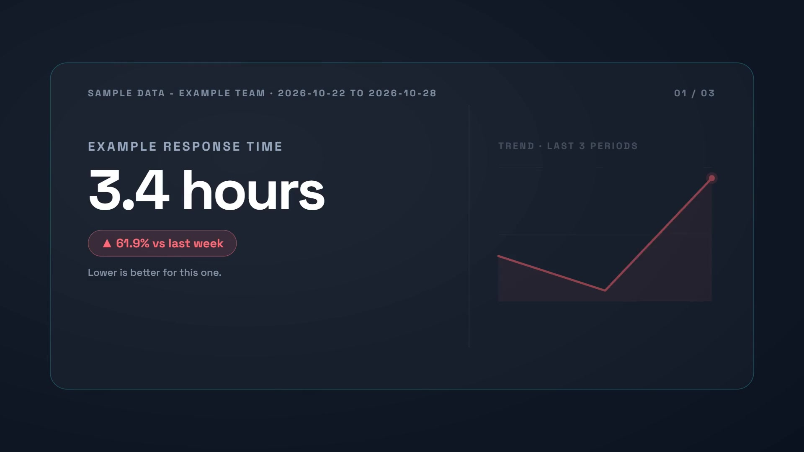

# Weekly KPI report video

Turn a checked reporting snapshot into a landscape KPI briefing and a CSV action register. The n8n workflow can send the completed video link to Slack. This Node.js companion accepts a local JSON snapshot, builds the same design, validates its credit quote and optionally renders with the official `@zvid/sdk`.

[](assets/sample-output.mp4)

The example has three illustrative metrics and two exceptions. Response time increases from 2.1 to 3.4 hours, revenue decreases from 150000 to 120000 USD, and conversion increases from 3.6% to 4.2%. It produces a silent 20.4-second, 1920 × 1080 MP4. The video shows relative percentage change, not percentage-point change. Its visible SAMPLE DATA labels remain in the title and report.

## Requirements

- Node.js 20.12 or later and npm.
- A Zvid account and an API key from https://app.zvid.io/api-keys for API validation and rendering.
- Zvid credits for an explicitly requested render.

Local preparation and tests need no credentials. This companion has no scheduler, automatic endpoint fetching, narration, music, Google Sheets log or Slack delivery. Use the included [n8n guide](n8n/README.md) for those workflow options. The default API origin is `https://api.zvid.io`.

## Install and prepare the example

From this folder:

```bash
npm ci
npm run check
npm test
npm run sample
npm run offline
```

`npm run sample` uses the fixed date 29 October 2026 to reproduce the checked-in project, source and review CSV for 22 to 28 October in `out/sample`. `npm run offline` creates the same labeled sample with current reporting dates in `out/live`. Neither makes network calls or spends render credits.

The shipped `config.json` chooses sample input, silent video and manual delivery. The n8n export retains its own defaults: live input and `dryRun: false`. For this CLI, only the explicit `--render` flag permits a paid submission; changing `dryRun` does not enable rendering.

Copy `.env.example` to `.env` and enter your key:

```dotenv
ZVID_API_KEY=your_zvid_api_key
```

Keep `.env` private. It is ignored by Git.

## Validate, then render

```bash
npm run validate
```

Read `out/live/result.json`: expect `state: "validated"`, `creditsQuoted` and any validation warnings. Inspect `project.json`, `source.json` and `review.csv` in that folder. Validation does not create a render job or consume render credits. The checked-in sample received a quote of 21 credits; this is a quote, not an audited billing total. Your returned quote governs your own request.

After reviewing the source and quote:

```bash
npm start -- --render --max-credits 25 --out out/first-render
```

Rendering requires a positive `--max-credits` ceiling and a positive `config.maxCreditsPerVideo`. The lower of those two limits applies; the script stops before submission if the quote exceeds it. On completion, `result.json` has `state: "completed"`, `jobId`, `videoUrl` and the available `outputExpiresAt`. Open the HTTPS video URL in a browser and download the MP4. The script saves the URL rather than downloading a video file automatically. Keep your own copy because output retention depends on the plan.

## Use real reporting data

Copy `config.json` to `config.live.json` and set `metricsSource` to `"live"`. Save a current reporting snapshot as `data/live-metrics.json`, following the shape of [sample-metrics.json](data/sample-metrics.json). Supply real values and current timestamps; omit `sampleData` for live input.

Required top-level fields are `company`, `periodStart`, `periodEnd`, `generatedAt` and `metrics`. Dates use `YYYY-MM-DD`; `generatedAt` is an ISO timestamp. Each metric needs unique `id`, `label`, finite numeric `value` and `previous`, and boolean `lowerIsBetter`. Optional fields are `unit`, `target`, `owner`, `action`, `alertPercent` and numeric `history`. History must have at least two points and end at the current value.

The reporting period must end before today in `timezone`. The snapshot must be newly generated, no more than `maxDataAgeHours` old (default 36), and cannot have a future timestamp. These are this example's reporting checks, not general Zvid project constraints. A historical report can use a fresh snapshot.

```bash
npm start -- --config config.live.json --input data/live-metrics.json --out out/live-report
npm start -- --config config.live.json --input data/live-metrics.json --render --max-credits 25 --out out/live-report
```

The first command validates only; the second explicitly renders. No reporting endpoint is contacted: `--input` is the file to read.

The example calculates `(value - previous) / abs(previous) * 100`. A zero baseline displays N/A. Target misses and adverse changes of at least `alertPercent` (default 10) require attention. The video selects up to five metrics, prioritizing attention, target misses and change magnitude; the CSV contains all metrics. Missing owners become Unassigned. `onlyExceptions: true` returns `nothing_to_render` when no metric requires attention.

## Recovery and duplicate limits

The script saves `submission-pending` before submission and saves an accepted job ID before waiting. Default polling is every 10 seconds for up to 20 minutes. Resume a saved accepted job without another render request:

```bash
npm start -- --config config.live.json --resume --out out/live-report
```

Use the original folder. Resume also works after a wait timeout. If `submission-pending` has no job ID, inspect https://app.zvid.io before another paid attempt. The SDK's automatic retries are disabled here: this companion makes one submission attempt and does not blindly retry an uncertain request or a capacity rejection.

A folder containing a paid attempt cannot be reused for a fresh attempt. The `.run.lock` file blocks concurrent use of that folder; after an interrupted process, confirm no process is still running before removing a stale lock. Different folders do not share a duplicate lock. Do not change output folders merely to bypass a pending submission.

## Troubleshooting

- **Missing API key:** set `ZVID_API_KEY` in `.env`, or use `--offline` for local preparation.
- **Snapshot or period rejected:** regenerate the source snapshot, check its dates/timezone and numeric values, and keep real timestamps rather than modifying them to pass validation.
- **Quote exceeds the ceiling:** inspect the quote and intended video before choosing a new limit. No render was submitted.
- **No completed result:** inspect the saved job ID in the dashboard. A timeout is not evidence that nothing was accepted.
- **Sample marker in live input:** live data must come from your reporting system; use `metricsSource: "sample"` for the supplied fixture.
- **Unsupported narration or Slack option:** use n8n for those branches. The CLI intentionally rejects them rather than silently ignoring them.

## Included evidence and links

- [Sample source](data/sample-metrics.json), [review CSV](data/sample-review.csv), [project](assets/sample-project.json), [plan](assets/sample-plan.json) and [reproduction metadata](assets/sample-output.json).
- [Actual n8n canvas](assets/workflow.png) and [synchronized workflow](n8n/workflow.json).
- [General Zvid walkthrough on YouTube](https://www.youtube.com/watch?v=i22Yzjlq9Tg). This is the supplied general walkthrough, not a KPI-specific demonstration.
- [Zvid validation guide](https://docs.zvid.io/docs/validate-and-estimate/) and [credits guide](https://docs.zvid.io/docs/credits-and-plans/).

Support: https://zvid.io/contact
