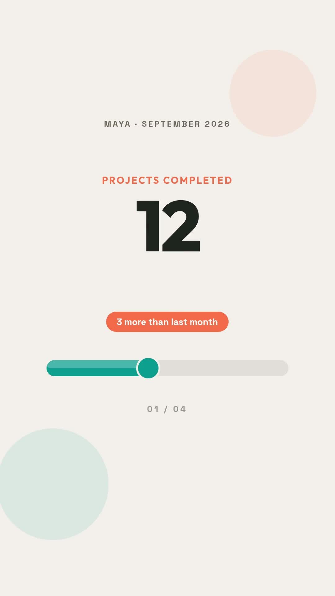

# Customer month-in-review stats video

Turn one customer's prepared metrics into a vertical recap with the official `@zvid/sdk`. The fictional example shows Maya's September 2026: 12 projects, 24 videos, Welcome series as the top project, and 4 hours of self-reported time saved. The workflow displays supplied values and comparisons; it does not calculate them.

[](assets/sample-output.mp4)

## Setup

Use Node.js 20.12 or newer. Open this directory and run:

```bash
npm ci
npm run check
npm test
npm run offline
```

Offline builds `out/live/project.json` and a summary without credentials or network calls. The supplied config is silent and uses no external source media. `assets/sample-output.mp4` is a retained real n8n output from the same fictional input and design. No new render is performed by tests.

Copy `.env.example` to `.env`. Create a key at https://app.zvid.io/api-keys and set `ZVID_API_KEY` in that private file. Never commit it. The API origin is https://api.zvid.io.

```bash
npm run validate
npm start -- --render --max-credits 17
```

The first command validates without spending render credits. The second validates and submits once only if the quote is no more than 17 credits. The retained sample received a 17-credit quote for 16.35 seconds at 1080 × 1920. This is a quote, not a billing audit; use your current response. The default `npm start` only validates; paid rendering requires `--render` and a ceiling, unlike the n8n export's `dryRun: false` default.

## Input and results

Edit `data/metrics.json`, or supply `--input path/to/metrics.json`. It accepts `{ userName, monthLabel, highlight, stats: [{ label, value, delta }] }`. `delta` is optional. Values can be numeric, including zero, or text. Arrays use their first customer only. Missing usable stats fail; no live-data error is replaced by demo figures.

The script reads a local input file; it does not fetch a reporting endpoint, calculate metrics, schedule runs, create an editor draft or send email. n8n provides the endpoint, schedule, editor draft and optional SMTP branches. Match a customer's identity, period and recipient before delivery. The sample time-saved figure is illustrative, not a measured Zvid claim.

Completed output URLs and expiry appear in `out/live/result.json`; open the HTTPS `videoUrl`, watch every card and save the MP4 before expiry. The script does not automatically download the video. Private run files contain customer-specific metadata and output links. Keep them out of source control.

## Recovery

```bash
npm start -- --resume
```

Resume waits for the recorded job without another submission. The accepted job ID is saved before waiting. A `submission-pending` state with no ID means the outcome is uncertain: inspect https://app.zvid.io before another paid attempt. Polling timeout does not cancel a queued job. The SDK has automatic request retries disabled for paid submission.

A paid attempt blocks a new execution in the same output folder. After reviewing its state, use an explicit new folder such as `--out out/customer-2` for an intentional new job. A process crash can leave `.run.lock`; verify no process is running before removing that lock. No automatic duplicate ledger exists across different output folders.

Authentication errors require correcting the key. Invalid stats need at least one nonempty label and value. A quote above the cap requires either a smaller design or an intentional higher ceiling. Failed renders must be investigated before creating a replacement.

## n8n route

See [n8n setup](n8n/README.md) and the synchronized [workflow export](n8n/workflow.json). The canonical bundled n8n demo uses Relay / July 2026 and optional image/music; the supplied Node fixture reproduces the recorded Cedarline Demo / September example. This is an input and branding difference, not a second design implementation.

The builder is executed from the reviewed, checked-in workflow's code nodes. The script does not accept arbitrary workflow code. Source, tests, sample metadata and workflow stay together.

For support: https://zvid.io/contact.
