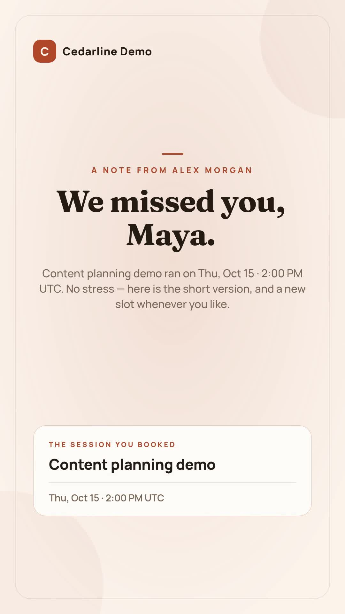

# No-show rebooking video

Turn one recorded webinar or demo no-show into a personal vertical recap and a rebooking invitation. The fictional sample is Maya's missed **Content planning demo**, hosted by Alex Morgan at Cedarline Demo. It is 1080 × 1920, about 15.07 seconds and silent. Its historical validation quote was 16 credits.

[](assets/sample-output.mp4)

The Node.js companion reads one local JSON record and reproduces the same project mapper as the n8n workflow. It validates by default. An explicit paid command renders and downloads the MP4. It does not detect attendance, connect Google Sheets, send email or run a schedule. The synchronized n8n workflow provides those queue and optional delivery steps.

## Requirements and setup

- Node.js 20.12 or later and npm.
- A Zvid API key from https://app.zvid.io/api-keys for API validation or rendering. Offline checks need no account.
- Enough Zvid credits for any render you explicitly request.

From this folder:

```sh
npm ci
npm run check
npm test
npm run offline
```

On Windows, use `npm.cmd` if PowerShell blocks `npm.ps1`. Copy `.env.example` to `.env`, then set `ZVID_API_KEY` to your complete key. Never commit `.env`. The script uses `https://api.zvid.io`.

`npm run offline` creates `out/sample/project.json` and `summary.json` without network requests or credit use. `npm run check` compares the generated project with the actual recorded sample project. Tests mock the API; they never render.

## Validate, render and recover

```sh
npm run validate
npm start -- --render --max-credits 20
```

Validation does not consume render credits. Review `out/sample/result.json` for the quote and warnings. Rendering consumes credits; the second command validates again and refuses a quote above 20. Choose your own maximum deliberately. It records submission intent before the request, saves the accepted job ID, waits for completion and downloads `out/sample/video.mp4`.

If waiting or downloading fails, use the same output folder:

```sh
npm start -- --resume --out out/sample
```

Resume checks the saved job and never submits a second render. If `result.json` says `submission-pending` without a job ID, the submission outcome is uncertain. Check recent renders in https://app.zvid.io before doing anything that could create another paid job. A failed render needs investigation; resume reports its failure and does not replace it.

For a genuinely new record:

```sh
npm start -- --input data/no-show.json --out out/new-person
npm start -- --input data/no-show.json --render --max-credits 20 --out out/new-person
```

The first command validates only. Use a distinct output folder per intended video. A lock stops simultaneous commands in the same folder. This is not a global customer deduplication database.

## Input and customization

Edit `data/no-show.json` and `config.json`. This companion requires nonempty `firstName` and `eventName`, two or three `highlights`, and an HTTPS `rebookUrl` when supplied. These are example application rules. The ISO `originalTime` is displayed in `config.timeZone`. Change `brandName`, `presenterName`, `presenterRole`, colors and invitation text for your own event. The supplied booking domain ends in `.example` and is illustrative; replace it before delivery.

This companion intentionally reproduces the silent sample and rejects a nonempty `musicUrl`. The n8n workflow supports optional music with an availability guard. No voice generation, attendance analysis or AI copywriting is performed. Highlights must describe the actual event.

The video displays a booking address but cannot contain a clickable link. Include the real booking link separately in your email or landing page. Review each MP4 before sharing it. Updated input does not modify an existing video.

## n8n alternative

Read [n8n setup](n8n/README.md) and import `n8n/workflow.json`. Install **`@zvid/n8n-nodes-zvid`** from **Settings → Community nodes** first; a workspace owner/admin may need to install it. The n8n download ships with `dryRun: false`, so its default run spends render credits. Set `dryRun: true` before the first setup check.

## Evidence and limits

`assets/sample-project.json` is the project used by the historical n8n render; `assets/sample-output.json` records its date, quote and file hashes without account identifiers. The current Node.js mapper reproduces that project exactly. A fresh paid Node.js render has not been claimed. There is no automatic email, Google token management, webhook service or duplicate suppression across different output folders in this script.

For help, visit https://zvid.io/contact. Include a redacted error and job ID when relevant; never share the API key.
