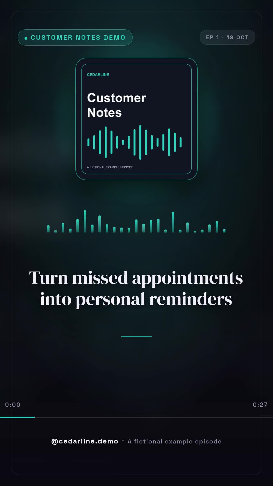

# Podcast to captioned audiogram clips

Turn the opening sample of a podcast RSS episode into one to three vertical audiograms. The same downloaded audio is transcribed, uploaded and used for rendering, so source changes between downloads do not shift the captions. The animated equalizer is decorative; it does not measure the audio waveform.



[Watch the real sample](assets/sample-output.mp4). This fictional Customer Notes Demo episode produces one 23.76-second, 1080 × 1920 clip with 18 caption cues. Its recorded validation quote was 24 Zvid credits. This is a historical output, not a guarantee of the next live quote or model selection.

## Requirements

- Node.js 20.12 or newer.
- A Zvid API key from https://app.zvid.io/api-keys for remote validation and rendering. Default API origin: https://api.zvid.io.
- For new episodes: a public audio RSS feed you may repurpose, an ElevenLabs API key with Speech to Text permission, and an OpenRouter key with sufficient credit.

The prepared sample requires no ElevenLabs or OpenRouter calls. A new episode uses one transcription request and one model selection request. External AI costs are separate from Zvid render credits. The script does not schedule itself or post to social accounts.

## Install and inspect the supplied sample

```bash
npm ci
npm run check
npm test
npm run offline
```

On PowerShell, use `npm.cmd` if script execution policy blocks `npm`. Offline mode builds `out/sample/projects.json` and `out/sample/clip-1.json` from the supplied transcript and selected moment. It uses the code nodes in the synchronized `n8n/workflow.json`; no requests or charges occur.

Copy `.env.example` to `.env` and fill in `ZVID_API_KEY`. Keep `.env` private. Validate and render the sample with:

```bash
npm run sample -- --validate
npm run sample -- --max-credits 30
```

The first command checks the project without queuing a render. The second renders only if the sum of current quotes is at most 30 credits. `out/sample/result.json` stores the job and completed video URL. Open each completed `videoUrl` to watch and download the MP4 before the link expires.

## Prepare your own episode

Fill in `ELEVENLABS_API_KEY` and `OPENROUTER_API_KEY` in `.env`. In ElevenLabs, create the key under Developers → API Keys and enable Speech to Text. In OpenRouter, create a key at https://openrouter.ai/settings/keys, give it a name, and set a spending limit suitable for the task. Update `config.json` with your HTTPS `feedUrl`, `showNameOverride`, `handle`, optional `coverImageOverride`, and clip settings. Start with `clipCount: 1` and `clipSeconds: 30`.

```bash
npm run prepare-podcast
npm run validate
npm start -- --max-credits 30
```

`prepare-podcast` explicitly enables upstream costs. It downloads a bounded opening sample, checks the actual byte length, transcribes once, uploads those same bytes, selects moments, and builds projects. It does not render. Review `out/live/prepared.json`, `projects.json`, and each clip's hook and source range before rendering. Invalid or unavailable model output falls back to simpler transcript selections, which still need human context review.

Preparation writes a status file before paid requests and refuses to repeat in the same folder. If interrupted, inspect the saved files and service account before deliberately choosing a new folder with `--out out/another-episode`; a new preparation can charge again. The script does not refresh credentials. Replace expired, revoked or exhausted keys in `.env` before future runs.

## Render controls and recovery

The n8n export and `config.json` ship with `dryRun: false`. A normal render command still requires a positive `--max-credits` ceiling. Set `dryRun: true` or use `--validate` for validation only. This render ceiling does not cover upstream transcription or model charges.

The script validates every clip before submitting any. It renders sequentially and saves a pending-submission marker before each call. Accepted job IDs are stored immediately. No submission is automatically retried, including capacity rejections. Inspect rejected or uncertain submissions before trying again.

```bash
npm run sample -- --resume
# For your own episode:
npm start -- --resume
```

Resume only polls accepted jobs. It never transcribes, submits, or retries a failed render. If interruption left later clips unsubmitted, resume stops at those entries after recovering accepted jobs. Review the saved projects and create a deliberately smaller new run for those remaining clips. A `submission-pending` entry without a job ID must be checked in https://app.zvid.io before any new render.

Each output folder has a `.run.lock` while a command runs. If the process was forcibly stopped, confirm no command still uses that folder before removing its stale lock. Keep `out/` private: live records can contain podcast source URLs and account job identifiers.

## Limits and customization

- Only the downloaded opening audio and configured time window are searched. The default is at most 4 MiB, also capped by `maxAudioBytes` (5,242,880 bytes). This is a byte limit, not an exact duration. A host that ignores Range and sends too much data is rejected before transcription.
- `clipCount` is one to three, `clipSeconds` is 10 to 90, and short transcripts may produce fewer clips. The default `minClipSeconds` is 18.
- The latest episode is selected each time. There is no processed-episode history. Add such a check before scheduling repeated preparation.
- Model hooks, selected context and transcription accuracy need review. Matching audio bytes prevents one source of timing drift; it does not guarantee transcription accuracy.
- The supplied sample uses an archived transcript and selection for reproducibility. A fresh transcription/model run can select different words or hooks.
- Branding, caption size and colors come from the maintained Config defaults and your overrides. For the supplied sample, edit its separate `data/sample.json` configuration.
- The Node.js script returns files and URLs. It does not create cloud editor drafts. Import `clip-1.json` in https://editor.zvid.io for a visual preview.

## n8n alternative

Read [n8n setup](n8n/README.md). Install **`@zvid/n8n-nodes-zvid`** in **Settings → Community nodes** before configuring Zvid credentials; a workspace owner/admin may need to install it. The export retains the maintained default and historical draft branch. Version 0.1.8 of the published node lacks Project operations; the setup explains removing that unavailable node and using manual editor JSON import before execution.

For support, visit https://zvid.io/contact.
