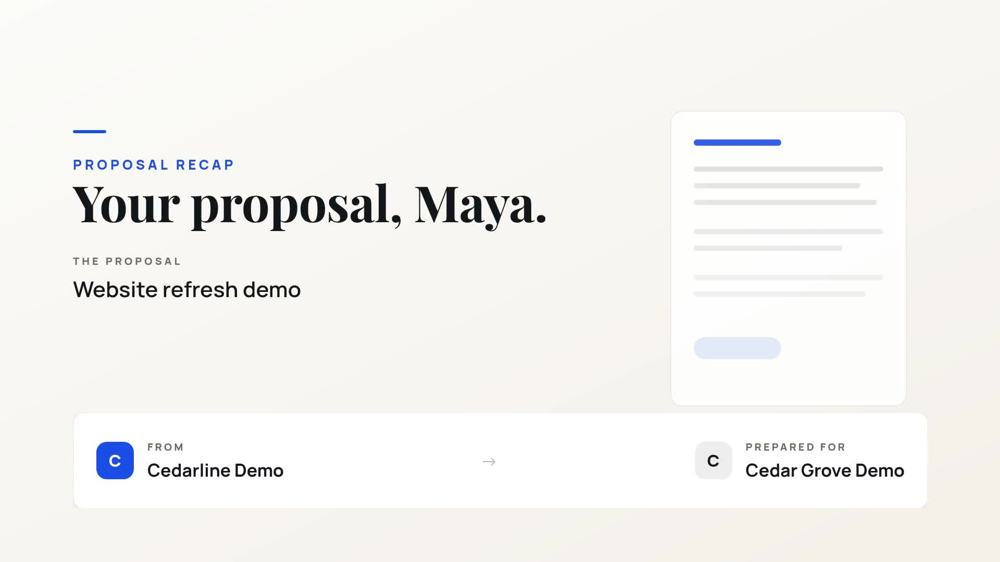

# Proposal recap video

Turn one deal into a landscape video showing its scope, investment, timeline and next step. This standalone Node.js example uses the official `@zvid/sdk` and the same video builder as the included n8n workflow.

[](assets/sample-output.mp4)

The fictional sample is a Website refresh demo for Maya at Cedar Grove Demo: USD 12,400, three scope lines, six weeks and a 30 November 2026 validity date. The real 1920 × 1080 sample lasts 24.8 seconds and has no audio. It came from a successful n8n run on 19 October 2026. The Node.js builder reproduces its project exactly; this repository does not claim a new paid Node.js render.

## Requirements

- Node.js 20.12 or later and npm.
- A Zvid API key from https://app.zvid.io/api-keys for validation or rendering.
- Sufficient render credits for a paid run. The sample quote was 25 credits; inspect your current quote.

## Install and check locally

Run these commands from this workflow folder after cloning the repository or extracting its standalone ZIP:

```sh
npm ci
npm run check
npm test
npm run offline
```

In Windows PowerShell, use `npm.cmd` if execution policy blocks the npm script launcher. No API key or network request is needed by the checks/tests/offline command after installation. `out/sample/project.json` holds the generated project, and `out/sample/summary.json` describes its layout, displayed amount and any shortened text. Offline mode does not probe or include optional music.

Copy `.env.example` to `.env`, put your private key after `ZVID_API_KEY=`, and save it. Do not commit or share `.env`. The API origin is `https://api.zvid.io`.

## Validate, render and recover

```sh
npm run validate
npm run render -- --max-credits 25
npm run resume
```

Validation checks the project and returns the current quote without consuming render credits. The render command performs another validation, refuses a quote above the supplied cap, then submits one paid render. The default `npm start` builds locally; payment requires the explicit `--render` switch even though the synchronized n8n export preserves `dryRun: false`.

The runner saves `out/sample/result.json` before and after submission, keeps the job ID before polling, and downloads the completed MP4 as `out/sample/video.mp4`. Watch it before delivery. `--resume` polls the saved job and retries the download without submitting a new render. If submission failed without a returned job ID, inspect your Zvid dashboard before trying a new output directory. A timeout does not prove a job failed.

Use one output folder per intentional new video:

```sh
npm start -- --input data/deal.json --config config.json --out out/deal-002
npm run validate -- --out out/deal-002
npm run render -- --out out/deal-002 --max-credits 25
npm run resume -- --out out/deal-002
```

Do not modify the source input between validation and a render unless you intend to render those changes. Rendering validates the current input again. A local lock prevents concurrent runs in the same output directory; a machine crash can leave `.run.lock`. Remove that lock only after verifying no process is running, then inspect the saved job with `--resume`.

## Customize

Edit `data/deal.json` for one deal and `config.json` for sender, branding, wording and optional music. `dealName`, `company` and a readable numeric `amount` are required by this example. Supply `currency` separately. Amounts are formatted, never converted or priced by the workflow. Use plain digits and an optional decimal point, such as `12400` or `148500.00`.

`scope` holds up to three short lines. With no scope the design omits that scene. Long names can be shortened on word boundaries; inspect `summary.json` for `truncated`. Use a real future `validUntil` for your own proposals. The sample's `.example` meeting address is a nonworking illustration: replace it before delivery. A URL shown in a video is not clickable, so place the working booking link alongside the video in your message.

Music is empty for the reproducible sample. On live validation/render commands, a configured HTTPS `musicUrl` is checked first; unreachable or oversized music is omitted. Use media you have permission to publish. The actual render quote depends on your final project and account limits.

## n8n alternative

Import `n8n/workflow.json` using the [n8n setup guide](n8n/README.md). Install **`@zvid/n8n-nodes-zvid`** through **Settings → Community nodes** before configuring Zvid credentials; an owner/admin may need to install it.

The n8n workflow reads the first pending Google Sheets deal or accepts a webhook. Its shipped `dryRun: false` renders immediately. Set `dryRun: true` during setup for validation and an editor draft. A successful sheet run writes `Status=sent` and the video URL. `sent` means the recap was prepared; no email is sent. The standalone Node.js runner reads one local JSON file and has no sheet, CRM, scheduling, email or editor-draft branch.

## Practical limits and recovery

- Keep the full proposal beside the recap. The video does not calculate tax, convert currency, enforce expiry, collect acceptance or replace your full scope and terms.
- Both implementations can spend credits again if you deliberately start a new render. The local saved-job guard is not a cross-machine duplicate registry.
- For `Zvid rejected the project`, fix the named fields and validate again. For an over-budget quote, review the content and set a deliberate cap.
- A saved failed job keeps its ID and reason. Inspect it before choosing a new output folder for an intentional retry.
- A failed MP4 download can be retried with `npm run resume`; it does not need a new render.
- API keys and Google authorizations can be revoked. Reconnect the affected credential rather than creating duplicate jobs.

Support: https://zvid.io/contact
