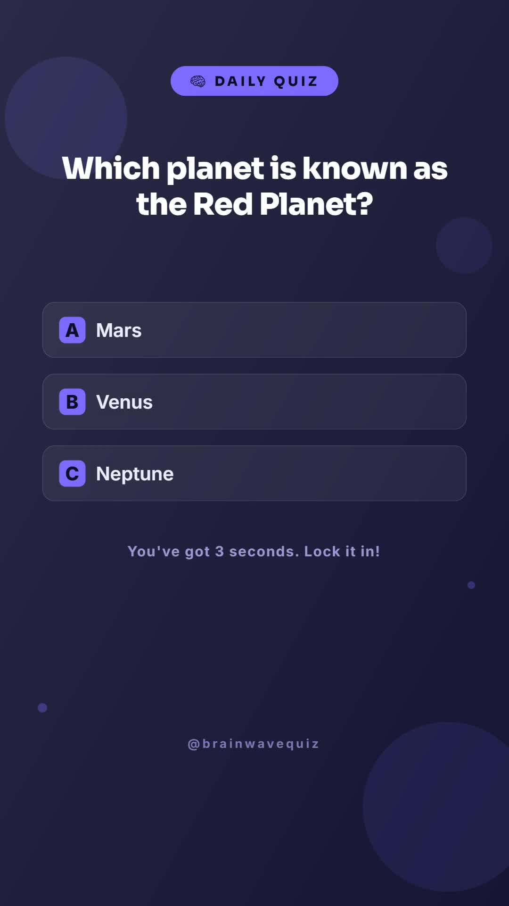

# Quiz Shorts from an approved question bank

Create one balanced quiz episode with an easy, medium and hard question. Each round shows a question, three choices, a countdown and a correct-answer explanation. A separate CSV keeps the answers and source URLs ready for review.

[Watch the sample](assets/sample-output.mp4)



The supplied fictional BRAINWAVE channel covers Mars, octopus hearts and tungsten. Its nine-scene 1080×1920 example is silent and was quoted at **44 Zvid credits**. This is a validation quote, not an audited billing total. The matching project is `assets/sample-project.json`.

## Setup and commands

Use Node.js 22.9 or newer. Run inside this workflow folder:

```bash
npm ci
npm run check
npm test
npm run offline -- --date 2026-10-29
```

The offline command writes `out/project.json`, `out/plan.json` and `out/quiz-shorts-review.csv`. It makes no API calls. `--date` fixes the rehearsal date used by answer-position rotation and the episode key; omit it for the current day.

Copy `.env.example` to `.env`, fill `ZVID_API_KEY` with your key from https://app.zvid.io/api-keys, and keep `ZVID_API_URL=https://api.zvid.io`. Never commit the key.

```bash
npm run sample -- --date 2026-10-29
npm start -- --date 2026-10-29 --max-credits 44
```

`sample` validates the design and saves `out/validation.json` without a render or history write. The normal command spends credits: `dryRun` is `false` in `config.json`. A positive `--max-credits` limit is mandatory for a new render. The stricter of this flag and `maxCreditsPerVideo` applies. Validate your own quote before choosing that limit.

## Questions, rotation and history

Edit `data/questions.json`; its column names match the n8n question sheet. The equivalent CSV is `data/questions.csv`.

- Supply one approved, unused question at each difficulty: `easy`, `medium`, `hard`. An incomplete set produces no episode.
- Each row needs a question of at most 130 characters, three distinct options of at most 40 characters, `CorrectLetter` A/B/C, a topic, a reviewed explanation of 1–200 characters, an HTTPS source URL and `Approval: approved`.
- Use a unique stable `QuestionKey`. A blank key is derived from normalized question text. Reusing the same question text under a different key does not bypass completed history.
- Answer positions rotate by date and key while retaining the correct answer. A copied answer letter may therefore differ from the final video and review pack.
- Topic diversity is preferred within an episode, then topics used less in the last `rotationEpisodes` completed episodes. Optional `topic` narrows the source pool.

The script uses `out/quiz-episodes.json` as persistent history. It does not read or write Google Sheets. Keep this folder between runs. A new `--out` folder has no history and can create duplicates. Changing `episodeRevision` creates a new date/revision identity but does not erase previously used question history.

## Completion and recovery

The script validates before saving submission intent, submits through the official `@zvid/sdk` with automatic retries disabled, saves the accepted job ID, polls completion and downloads the MP4. Each API request has a two-minute timeout; status requests also honor the remaining polling deadline. It stores failed and uncertain states for inspection. One output folder can be used by only one process at a time.

```bash
npm start -- --resume
```

Resume checks an already accepted job and retries its download. It never submits a replacement render. After a timeout or interrupted download, keep the history and use this command. If a request was accepted but its ID was not saved, inspect the Zvid dashboard before manually reconciling that one record. Do not delete history as a retry strategy.

An explicit HTTP 429 rejection records a delay of at least 30 seconds. Wait for the reported delay and run the normal command again; it revalidates before another submission. The companion does not automatically loop over these capacity rejections. Unknown submission errors require inspection.

The sample has no music or narration. Leave `musicUrl` empty in this companion. There is no built-in scheduler, Google Sheets connector or social publishing. It processes one episode per invocation. If a process is interrupted and leaves `.run.lock`, confirm it stopped before removing that lock. Overlapping runs using different output folders are not coordinated.

## n8n alternative

Install **`@zvid/n8n-nodes-zvid`** from **Settings → Community nodes** before configuring credentials. A workspace owner/admin may need to install it. Import `n8n/workflow.json` and follow [the n8n setup](n8n/README.md).

The n8n version reads a Google Sheets question bank, maintains its separate **Quiz Episodes** recovery tab, checks optional background music, and can use a daily schedule. It has up to three automatic attempts for explicit capacity rejections. Its dry-run route returns the plan, project and quote; it does not create an editor draft. All supported Zvid operations use the native community node.

Watch the full MP4, check every answer and source, then upload it manually to your channel. Existing videos do not update after a question-bank edit.

Support: https://zvid.io/contact
