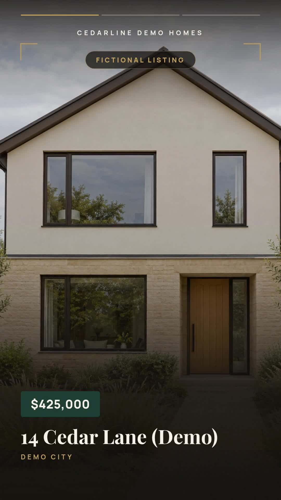

# Property listing videos from a JSON queue

Create one vertical property reel from the first listing whose `Status` is empty. This Node.js companion uses the same field normalization and video builder as the bundled n8n workflow. It reads a local JSON file, validates the project with the official `@zvid/sdk`, and renders only when explicitly requested.

[](assets/sample-output.mp4)

The fictional example is **14 Cedar Lane (Demo), Demo City**, priced at **$425,000**, with **3 beds, 2 baths and 1,800 sq ft**. Its two demonstration images become a 12.5-second, 1080 × 1920 MP4 with an agent monogram and no audio. These illustrations do not depict a real listing. The historical validation quote was **13 Zvid credits**, not an audited billing total. Request a current quote before rendering.

## Choose n8n or Node.js

- [Official n8n template](https://n8n.io/workflows/20261-create-real-estate-listing-videos-with-google-sheets-airtable-and-zvid/): reads Google Sheets or Airtable. Sheet mode writes `Status` and `VideoUrl` after success. Use the maintained [workflow JSON](n8n/workflow.json) and [setup guide](n8n/README.md) in this folder.
- This script: reads `data/listings.json`; writes a project, state file and finished MP4 locally. It does **not** connect to Sheets or Airtable, update the input, schedule runs, save an editor draft, add music or publish videos.

The n8n JSON ships with `dryRun: false`, which renders and spends credits. Change it to `true` before your first n8n setup check. The Node.js command validates by default and requires `--render --max-credits N` for a paid submission. `dryRun` in the n8n export does not control the script.

## Requirements and setup

Use Node.js 22 or newer. Run the commands below from this workflow folder, or from the root of its standalone ZIP.

```sh
npm ci
npm run check
npm test
npm run offline
```

The last three commands make no network requests and spend no credits. `check` compares the current builder output with the actual retained sample project. Offline mode writes `out/offline/project.json` and `out/offline/result.json`.

For API validation or rendering, copy `.env.example` to `.env`, then put your complete Zvid key after `ZVID_API_KEY=`. Create a key at [app.zvid.io/api-keys](https://app.zvid.io/api-keys). Keep `.env` private; it is ignored by Git. The API origin is `https://api.zvid.io`.

```sh
npm start -- --input data/listings.json --out out/cedar
```

This validates and saves the project and quote. It creates no render job and consumes no render credits. Inspect the `creditsQuoted` and `warnings` in `out/cedar/result.json`, plus the project. You can import `project.json` into [editor.zvid.io](https://editor.zvid.io) to inspect the design.

## Render, recover and download

After reviewing the current quote, explicitly enable rendering. The limit below matches the historical two-photo example; if the current quote is higher, the command stops without submitting.

```sh
npm start -- --input data/listings.json --render --max-credits 13 --out out/cedar
```

The script validates again, enforces the quote limit, writes `submission-pending`, submits once, saves the returned job ID, waits for completion, and downloads `out/cedar/video.mp4`. It records the quoted credits separately from actual billing.

If waiting or downloading fails after a job ID was saved:

```sh
npm start -- --resume --out out/cedar
```

Resume checks that job and downloads its output without submitting again. If the state is `submission-pending` without a job ID, inspect recent renders in [app.zvid.io](https://app.zvid.io) before deciding whether another submission is appropriate. Automatic paid-request retries are disabled. Explicit `429` capacity rejection records `retryAt`; wait until that time, then rerun the original input command. Resume cannot poll a rejected submission.

Downloads are checked for an MP4 header and complete declared length, then saved with an atomic rename. If downloading fails, use `--resume` to retrieve the completed output again.

Each output folder has a simple exclusive run lock. After a process crash, remove a stale `out/cedar/.run.lock` only after confirming that no process is using that folder. The paid-attempt guard still requires recovery or review of the saved state. This is a local execution guard, not a distributed queue lock.

## Change the input and design

`data/listings.csv` carries the same sample row for the n8n Google Sheets route. The script reads JSON, not CSV. JSON inputs are arrays with these fields:

| Field | Meaning |
| --- | --- |
| `Address` | Required property address or approved display label. |
| `Photo1` to `Photo5` | At least two direct public HTTPS image URLs. `Photo1` is the hero; at most five are used. |
| `City`, `Price`, `Beds`, `Baths`, `Sqft` | Optional displayed facts. Plain `425000` becomes `$425,000`; `1800` becomes `1,800`. Formatted strings remain as supplied. |
| `AgentName`, `AgentPhone`, `AgentPhotoUrl` | Optional contact fields. An empty portrait uses initials. |
| `Status` | Empty selects a row; any nonempty value skips it. Keep this header's exact capitalization. |
| `VideoUrl` | Used by n8n write-back; the local script does not update it. |

Use only approved facts and photos of the exact property for a real listing. Do not replace missing real rooms with unrelated or generated interiors. Images use a central portrait crop; review all scenes before sharing. The displayed contact URL is text inside the video, so put a working link in the surrounding listing page or post.

Edit `config.json` for the brokerage name, labels, contact URL, colors, typography and `kenBurnsDepth`. It uses `1.08` for the sample; the canonical n8n default is `1.14`. The script requires `source: "sheet"` to select the local rows using the same field rules and requires empty `musicUrl`. For optional music or Airtable, use the n8n route.

The script does not mark input rows complete. After successful review, update your queue deliberately before creating another output folder. Re-running the same input in a new folder can render the same listing again. Facts changing in the input do not update an existing MP4.

## Files and verification

- `assets/sample-output.mp4` and `.jpg`: actual historical output and poster.
- `assets/sample-project.json`: the exact project used for that output.
- `assets/sample-output.json`: sanitized reproduction metadata and hashes.
- `assets/workflow.png`: actual recorded n8n canvas. It shows the earlier editor-draft node; the maintained JSON uses the documented HTTP exception.
- `n8n/workflow.json`: canonical synchronized download, without credentials.

Tests cover queue selection, incorrect headers, required photos, price formatting, escaping, five-photo pacing, quote limits, no-render modes, recovery and uncertain submissions. These offline tests do not establish fresh Sheets or Airtable execution.

For help, visit https://zvid.io/contact.
