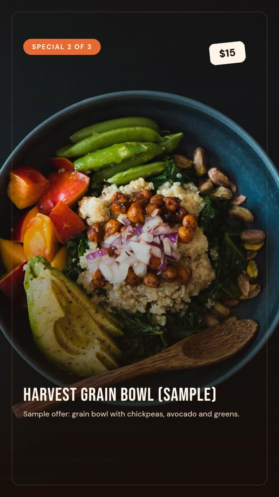

# Restaurant weekly specials video and caption plan

Turn approved menu records into one vertical specials video and three dated caption drafts. This companion uses the selection rules and design from the bundled n8n workflow. It reads local JSON instead of Google Sheets and stores a local campaign history. It does not publish posts, book tables, manage inventory or infer ingredients and allergens.

The fictional Cedarline Demo Kitchen sample contains tomato pasta ($19), a harvest grain bowl ($15) and a strawberry dessert ($11). Its completed 1080 × 1920 MP4 lasts 12.9 seconds, has no audio, and was quoted at 13 credits. The demonstration week is 19–25 October 2026. Review the whole sample before adapting it.

[](assets/sample-output.mp4)

## Setup

Use Node.js 22 or newer. Run these commands from this folder:

```bash
npm ci
npm run check
npm test
npm run offline
```

The offline command creates `out/sample/project.json`, `result.json` and `posting-plan.csv` without API calls or credit consumption. It fixes the demonstration date at 22 October 2026, so old Monday/Wednesday captions are marked `past_date_do_not_publish`. The CSV is a plan, not a publishing schedule.

Copy `.env.example` to `.env` and put a complete Zvid API key from https://app.zvid.io/api-keys in `ZVID_API_KEY`. The API origin is `https://api.zvid.io`. Never commit `.env` or copy the key into input files. The script uses the official `@zvid/sdk`.

## Validate, render and recover

This CLI validates by default even though the n8n export ships with `dryRun: false`. The following command checks the sample with Zvid and returns a quote without rendering or writing campaign history:

```bash
npm start -- --input data/menu.json --date 2026-10-22 --out out/preview
```

Review the result and `project.json`. Rendering spends credits. Submit one deliberate paid render only when ready:

```bash
npm start -- --input data/menu.json --date 2026-10-22 --render --max-credits 30 --out out/render
```

The smaller of `--max-credits` and `config.json`'s `maxCreditsPerVideo` is enforced before submission. The script saves `submitting` to `out/campaign-history.json`, submits once, stores the accepted job ID, waits with a deadline, then downloads `video.mp4`. It also writes the three-caption `posting-plan.csv`. The default local lock prevents simultaneous commands sharing that history file. It is not a distributed lock across copied folders or hosts.

After an interrupted wait or failed download, reuse the original history and accepted job:

```bash
npm start -- --resume menu-2026-10-19-1 --out out/render
```

Resume uses the saved project and captions. It does not rebuild the menu or submit another paid render. A completed campaign is skipped during ordinary input runs. `--resume` can download its saved completed output again while the URL remains available.

If the history remains `submitting` without a job ID, inspect recent jobs at https://app.zvid.io before changing the record. A network error may hide an accepted render. Failed and uncertain jobs require inspection; do not delete state to force another run. A `429` response is not retried automatically. Inspect the response and job history, then honor the supplied retry delay before a deliberate retry. Output URLs expire according to the render's plan; retain downloaded MP4s.

## Use a current menu

`data/menu-current-week.json` contains the three sample dishes with blank availability dates. Blank dates deliberately mean no date restriction. For real promotions, replace the sample branding, reservation URL, photos, prices, descriptions and availability before rendering:

```bash
npm start -- --input data/menu-current-week.json --out out/current-preview
```

Omit `--date` for the current date in `config.json`'s timezone. Supply real YYYY-MM-DD availability dates that cover the full Monday–Sunday week. The application requires unique `DishKey`, `Dish`, `Category`, `Price`, public HTTPS `PhotoUrl`, `ThisWeek: true`, `InStock: true` and `Approval: "approved"`. Optional fields are `Description`, `Priority`, `AvailableFrom` and `AvailableUntil`.

At least 3 dishes across 2 categories are required by default; at most 5 are supported. Selection takes category variety first, favors higher priorities and rotates equal-priority dishes using the previous week's completed local history. A dish available only from Friday is not eligible for a full-week campaign. If the selection fails, `result.json` explains why and no render is submitted.

`campaignRevision` is part of the weekly campaign key. Change it only for an intentional replacement that may cost credits. Keep one durable `--history` path across runs so duplicates and prior-week rotation can work. Importing an n8n campaign log into the CLI is a manual JSON conversion; the script does not synchronize Google Sheets.

## n8n alternative

Install **`@zvid/n8n-nodes-zvid`** in **Settings → Community nodes** before configuring credentials. A workspace owner/admin may need to install it. Import `n8n/workflow.json`, keep its schedule inactive, connect Zvid and Google Sheets, then follow [the complete n8n setup](n8n/README.md).

The n8n export ships with `dryRun: false`, a 30-credit per-video ceiling, up to 5 dishes and a Monday 09:00 trigger. Set `dryRun: true` for the first plan and quote. The CLI sample uses 3 dishes and no music. Both use the same selection functions and design; they do not share campaign history automatically.

## Troubleshooting

- `menu_needs_revision`: inspect excluded rows and category count. Approve factual menu data; do not weaken rules merely to force a result.
- Quote exceeds limit: reduce the design or consciously raise the ceiling after reviewing the quote.
- `401`: replace an invalid or revoked API key. Never repeatedly submit with invalid credentials.
- Existing `.lock` after a crash: confirm no process uses that history before removing the stale lock. Keep the history itself.
- Media download failure: reuse the completed saved job. Do not render again solely to retry a download.

The UI captures and output were recorded on 22 October 2026. Media URLs in the runnable sample are retained on the Zvid CDN; source URL migration does not represent a newly rendered result. Details and checksums are in `assets/sample-output.json`. For help, use https://zvid.io/contact.
