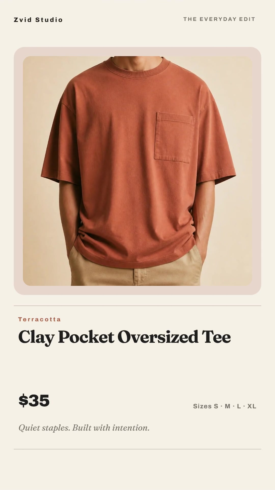

# Shopify catalog videos

Create a branded vertical video for each eligible Shopify product, review the results, and optionally attach them to their matching products. The Node.js script uses the official `@zvid/sdk` and the same catalog mapper and video builder as the included [n8n workflow](n8n/workflow.json).

[](assets/sample-output.mp4)

[Watch the sample MP4](assets/sample-output.mp4) · [Published workflow walkthrough](https://youtu.be/qe5KHfJoZmY) · [Source project](assets/sample-project.json)

The sample is a fictional catalog entry using Zvid's demonstration product image. It produces a silent, three-scene, 1080 × 1920 product video. The one available image is reused in the four image positions. The included output was rendered locally from the project returned by Zvid's live validator. See [reproduction metadata](assets/sample-output.json).

## What happens

1. Read one Shopify catalog page, with `scanLimit: 100` and `maxProducts: 5` by default.
2. Skip inactive products, products tagged `zvid-video`, existing non-failed videos, and products missing usable titles, images, prices or product IDs.
3. Build a shared design with each product's photos, title, price, description bullets and sizes. Validate every selected product and add its quoted credits to the batch total.
4. Render one bulk batch, save its receipt, and poll for results. Match jobs using their original submission indices and product IDs.
5. Return video URLs for review. Optionally stage each completed MP4 in Shopify, attach it to the correct product, and add the processed tag only after Shopify accepts the association.

The shipped default is **`dryRun: false` and `publishToShopify: false`**. `npm start` renders and spends Zvid credits when credentials are configured. `--dry-run` performs free validation. Shopify publishing requires a separate explicit option or configuration change.

## Requirements and setup

- Node.js 20.12 or newer.
- A Zvid API key from [https://app.zvid.io/api-keys](https://app.zvid.io/api-keys).
- For a live catalog, a Shopify Admin API access token with `read_products`. Optional publishing also needs `write_products` and `write_files`. The script uses GraphQL Admin API `2026-07`.
- Product images that Zvid can fetch publicly. Use media you have permission to publish.

```bash
git clone https://github.com/Zvid-io/workflow-examples.git
cd workflow-examples/workflows/shopify-catalog-videos
npm ci
npm run check
npm test
```

Copy `.env.example` to `.env`, then fill in the three values:

```dotenv
ZVID_API_KEY=
SHOPIFY_ACCESS_TOKEN=
SHOPIFY_SHOP_DOMAIN=
```

Use only the store subdomain: `acme` for `acme.myshopify.com`. The access token is not a client ID or client secret. Obtain and maintain a token using Shopify's [authentication guide](https://shopify.dev/docs/apps/build/authentication-authorization). Token refresh is outside this example.

Edit `config.json` to set `brandName`, `website`, the palette, copy labels, catalog query and product cap. The sample copy is apparel-oriented; review fallback description text and size labels before using another product category. Product text is normalized and escaped by the shared builder.

The script connects to `https://api.zvid.io`. Secrets belong in `.env`, never in config, fixtures, exported workflows or Git.

## Run locally without credentials

```bash
npm run offline
```

This builds the sample template and variable values in `out/live/batch.json`. It does not call Shopify or Zvid, validate remotely, or render. Automated tests also run without credentials or paid API calls.

## Preview, render and recover

```bash
# Read your Shopify catalog and validate every selected project for free.
npm run dry-run

# Render only if the combined validation quote is at most 100 credits.
npm start -- --max-credits 100

# After a timeout, retrieve the existing batch without submitting another one.
npm start -- --resume
```

The free preview saves resolved projects as `out/live/product-1.json`, `product-2.json`, and so on. It does not create an editor draft. You can inspect these files or import a project into [the visual editor](https://editor.zvid.io). The n8n version also has a save-to-editor branch.

The run journal is `out/live/result.json`. It contains validation quotes, the accepted batch receipt, skipped-product reasons, per-product video URLs, render failures and publication results. Keep it private: live runs include your catalog identifiers and output URLs. Watch the completed URLs before publishing. Videos are not downloaded locally by the rendering command.

Each output directory can hold one paid run. Once submission starts, a second start is refused. Use `--resume` for recovery, or choose a new directory with `--out out/next-batch` only when you intend a new paid batch. This protects that directory only; two separate directories or machines can still submit duplicate work.

### Reproduce the included sample

```bash
# Free validation of the fictional sample; only ZVID_API_KEY is needed.
node src/index.js --fixture data/catalog.json --dry-run --out out/sample

# A paid API reproduction, capped at the sample's recorded quote.
npm run sample -- --max-credits 13
```

The live validator quoted **13 credits** for this sample on 27 October 2026. This is a validation quote, not an audited charge. The checked-in MP4 was rendered locally without spending API render credits. Quotes, availability and rendering details can change; inspect your own fresh result. Sample product ID `gid://shopify/Product/1` and storefront `example.com` are illustrative. Fixture runs are blocked from Shopify publishing.

## Optional Shopify publishing

After reviewing the completed live videos:

```bash
npm start -- --resume --publish-to-shopify
```

This changes product media in your store. It uploads completed MP4s using Shopify's [staged upload flow](https://shopify.dev/docs/api/admin-graphql/2026-07/mutations/stagedUploadsCreate), then [adds product media](https://shopify.dev/docs/api/admin-graphql/2026-07/mutations/productUpdate) and the configured processed tag. It does not change titles, prices, descriptions, variants or existing tags. Shopify processes video asynchronously; `processing` in the journal means the association was accepted, not that the media is already ready on the storefront. Check media status in Shopify Admin.

Failed renders are never uploaded. Upload or association failures never trigger tagging. The journal records an association attempt before sending it; resume will not repeat that association automatically. If the association succeeds but tagging fails, inspect the product and add the tag manually rather than uploading the video again.

## Costs, boundaries and troubleshooting

- **No automatic retry of writes:** SDK retries are disabled and Shopify writes are not retried. A timeout can occur after the server accepted a request. If the journal says `submission-pending` with no receipt, inspect [the Zvid dashboard](https://app.zvid.io) before attempting another render.
- **Polling:** the default interval is 10 seconds and the wait limit is 20 minutes. A timeout does not cancel a render. Resume from the saved receipt.
- **Catalog coverage:** one page of up to 250 products is read per run. There is no cursor traversal. `moreCatalogPages` tells you that additional candidates exist. Narrow the query when older products are crowded out by products already containing video.
- **Queue progress:** review-only rendering does not add Shopify tags. A new run can select the same products. Publish/tag accepted products or narrow the query before creating another batch.
- **Incomplete batches:** successful videos remain in the journal alongside failures. The command exits nonzero for render or publication errors. Retry only after checking existing results.
- **401/403:** check the actual Admin API token, store subdomain, installation and required scopes. Expired tokens must be refreshed outside this script. Shopify GraphQL and rate-limit errors are surfaced without automatic retries.
- **Missing image or validation failure:** inspect the skipped reasons and resolved JSON. Use accessible product-image URLs and short copy. Every selected product must validate before submission.
- **Publishing limits:** this small example buffers one MP4 at a time and caps each at 100 MiB. It does not poll Shopify transcoding, schedule store-wide publishing, or coordinate concurrent runs across machines.
- **Interrupted process:** a `.run.lock` file prevents concurrent use of the same output directory. If a process crashed, confirm it has stopped before removing that file, then resume the journal.

The automated tests cover validation, credit limits, product selection, stable result mapping, recovery, fixture safeguards and staged-upload behavior. The current Node.js Shopify write path is tested with mocked responses; running this verification did not modify a live store. It is a starting point for your integration, not a managed scheduler.

## n8n and links

See [n8n setup](n8n/README.md) for the synchronized workflow export and actual canvas screenshot. Install **`@zvid/n8n-nodes-zvid`** from **Settings → Community nodes** before configuring Zvid credentials; a workspace owner/admin may need to install it.

- [Zvid workflow library](https://zvid.io/n8n/workflows)
- [Zvid documentation](https://docs.zvid.io)
- [Workflow walkthrough](https://youtu.be/qe5KHfJoZmY)
- Support: [https://zvid.io/contact](https://zvid.io/contact)

Code is MIT licensed. The demonstration media is provided as an example; the code license does not grant rights to arbitrary merchant images or third-party media.
