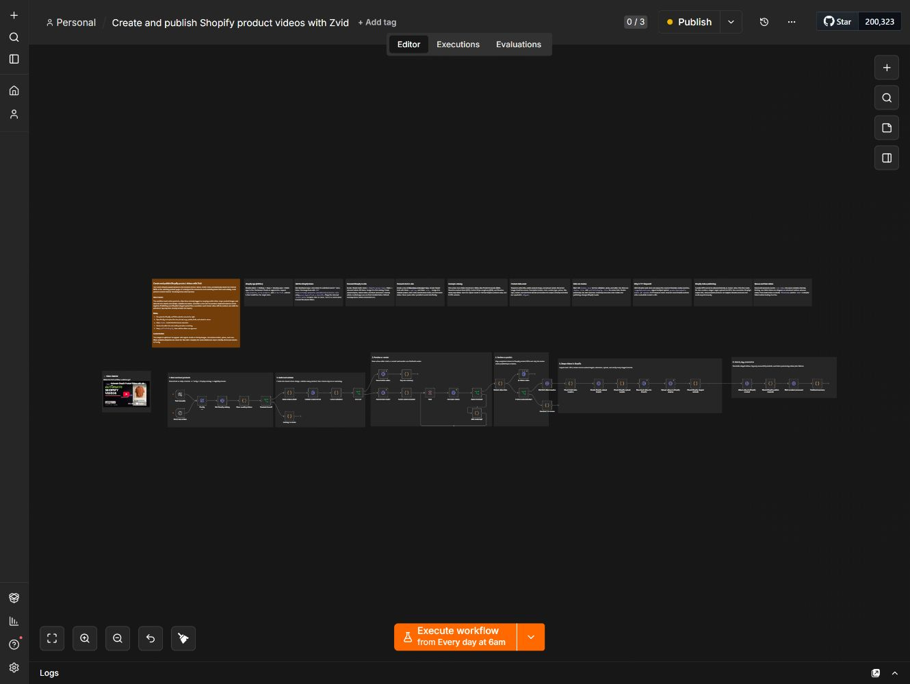

# n8n setup

1. Install **`@zvid/n8n-nodes-zvid`** from **Settings → Community nodes** before setting up Zvid credentials. A workspace owner/admin may need to install it.
2. Import [workflow.json](workflow.json).
3. Create a **Zvid API** credential using a key from [https://app.zvid.io/api-keys](https://app.zvid.io/api-keys), with base URL `https://api.zvid.io`. Select it on every Zvid node.
4. Create a **Header Auth** credential with header name `X-Shopify-Access-Token` and your Shopify Admin API access token. Select it on the Shopify catalog, staged-target, product-media and processed-tag requests. Do not use a client secret as the access token.
5. In **Config**, set `shopDomain` to the store subdomain, then edit the branding, storefront URL, query and product cap.
6. The default **`dryRun: false`** renders and spends credits after validation. Set it to **`true`** for a free quote and editor draft. Keep **`publishToShopify: false`** for review-only results.
7. Run manually, inspect the completed **Watch video** output, and enable publishing or scheduling only when you are ready.

Shopify catalog reads need `read_products`. Publishing also needs `write_products` and `write_files`. Shopify GraphQL and staged multipart uploads use HTTP Request nodes because those are Shopify operations. Supported Zvid operations use the official scoped Zvid node.

The export is copied byte-for-byte from the canonical `zvid-shopify-catalog-videos.json` integration workflow. Its SHA-256 is recorded in [sample-output.json](../assets/sample-output.json). The Node.js implementation loads its mapper and project builder directly from this export. Node.js adds per-product validation, a local recovery journal, explicit product-status/tag/price guards and a credit ceiling; the n8n flow retains its own batch validation and editor-preview behavior.

This actual canvas capture was retained from the August 2026 walkthrough. It shows the earlier note layout and HTTP-based Zvid steps. The synchronized export includes the later native Zvid-node migration and updated notes. Import the JSON to inspect the current canvas.

One catalog page is inspected per run; narrow the query when needed. Keep the Shopify token valid for scheduled runs. Shopify association is asynchronous: confirm media becomes READY in Shopify Admin. Avoid retrying an ambiguous render or upload before checking its result.

[Published walkthrough](https://youtu.be/qe5KHfJoZmY) · [Node.js guide](../README.md) · Support: [https://zvid.io/contact](https://zvid.io/contact)
