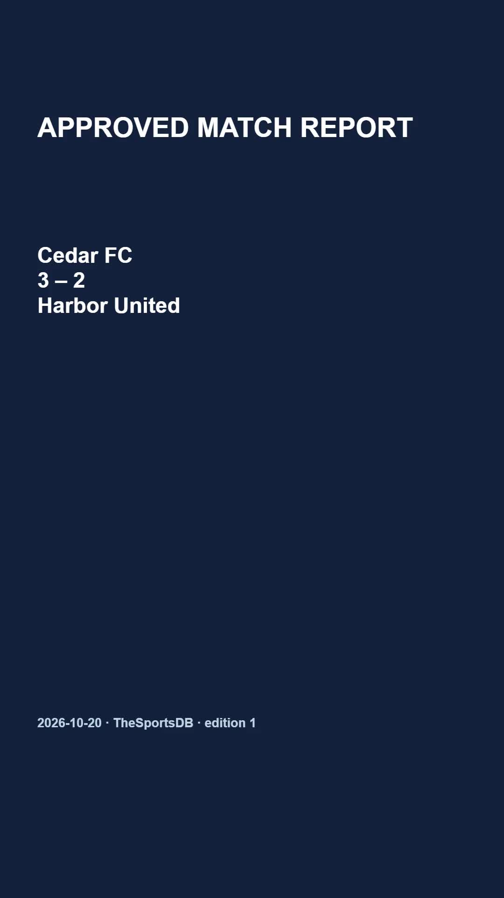

# Sports recap video

Review a match result, approve its exact facts, then render a portrait report with Zvid. A changed result invalidates approval; a correction preserves the previous result and video link. This companion reuses approval and design code from `n8n/workflow.json`.



[Play the rendered sample](assets/sample-output.mp4). Cedar FC, Harbor United, the event ID and Community Cup fixture are fictional, not a real TheSportsDB result.

## Setup and sample

Use Node.js 20.12 or newer. Remote validation/rendering requires a Zvid API key from https://app.zvid.io/api-keys. The sample received a 12-credit quote; validate your own design.

```bash
npm ci
npm run check
npm test
npm run offline
```

Offline writes project.json and result.json under `out/offline`, without API calls or a new MP4. See `assets/sample-output.json` for sample reproduction metadata.

Copy `.env.example` to `.env`, enter `ZVID_API_KEY` and keep the file private. The SDK uses https://api.zvid.io.

```bash
npm run dry-run
npm start -- --render --max-credits 35
```

Validation does not consume render credits. Rendering spends credits and requires exact approval plus a quote within both `--max-credits` and `maxCreditsPerVideo`. Unlike n8n's shipped dryRun=false, this CLI requires explicit `--render`.

## Real-event review

Copy `data/match.json` to `data/live-match.json`. Replace request.EventId with a real numeric TheSportsDB event ID. Clear request.Approval and request.ApprovedSnapshot. Start with empty history only for a genuinely new event. Set SPORTSDB_API_KEY in .env and select the expected leagueId in config.json, or use an empty string.

```bash
npm start -- --offline --fetch --input data/live-match.json --out out/match-review
```

This contacts TheSportsDB without calling Zvid. Review plan.fact and plan.reviewSnapshot in the output against the source. To approve, enter approved in request.Approval and copy the complete snapshot string into request.ApprovedSnapshot, preserving JSON escaping. Nonfinal or invalid source records stop rather than substituting a fixture.

```bash
npm start -- --dry-run --fetch --input data/live-match.json --out out/match-live
npm start -- --render --fetch --input data/live-match.json --out out/match-live --max-credits 35
```

Keep --fetch on real-event commands so source facts are checked again. It replaces the input response in memory and does not overwrite your input file. Without --fetch the saved response is used; that is not a fresh source check.

## Output, corrections and recovery

The output folder contains project.json and result.json. A completed result has jobId, videoUrl, outputExpiresAt when supplied, and completedHistoryRow. Open videoUrl and download before expiry.

For a correction, append the exact completedHistoryRow object to the input's history array. Preserve prior rows and output folders. Clear approval, fetch again for review, approve the new snapshot and use a new output folder for the intentional new edition. An unresolved prior attempt must be inspected first.

```bash
npm start -- --resume --out out/match-live
```

Resume polls the saved accepted job without another paid submission. A timeout may leave a running job. A submission-pending state may mean the response was lost after remote acceptance. Check the Zvid dashboard before submitting again. Automatic SDK retries on submission are disabled.

A folder with completed/submitted/uncertain work blocks a new run. A local .run.lock blocks concurrent use of that folder; remove a leftover lock only after confirming no process uses it. Separate folders are not a distributed lock. Coordinate callers and preserve event history.

The companion does not update Sheets, rotate a queue, make a CSV, publish social posts or check optional music. Leave musicUrl empty. It does not calculate fantasy points, standings or rosters and needs no LLM.

## n8n

Install **@zvid/n8n-nodes-zvid** from **Settings → Community nodes** before credentials; an owner/admin may need to install it. Import n8n/workflow.json and follow [n8n setup](n8n/README.md). Supported Zvid actions use native nodes.

The [official listing](https://n8n.io/workflows/20489-create-verified-sports-recap-videos-with-thesportsdb-and-zvid/) describes the earlier period recap. This maintained export uses event approval/correction. assets/workflow.png is a historical authentic editorial canvas, not evidence of a new live run.

Support: https://zvid.io/contact
