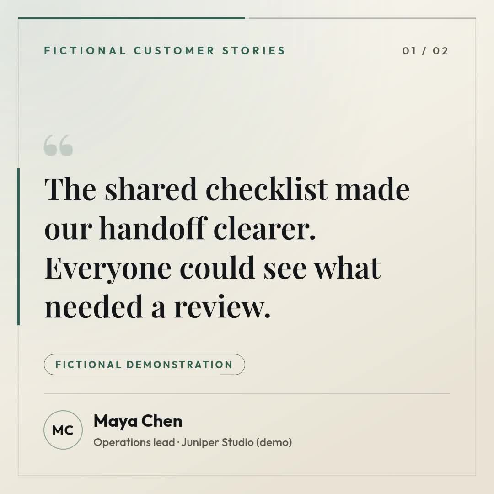

# Monthly testimonial compilation

Turn selected, approved testimonial rows into one square video: an introduction, one card per quote and a closing invitation. This Node.js companion uses the scene builder and selection code from the synchronized n8n template.

[](assets/sample-output.mp4)

The supplied Cedarline Demo example contains two fictional quotations and runs for 19.9 seconds at 1080 × 1080, 30 fps, without audio. Its original validation quoted 20 credits. No customer result is implied.

## Choose a route

- [Official n8n template](https://n8n.io/workflows/20097-compile-monthly-testimonial-videos-from-google-sheets-or-airtable-with-zvid/): Google Sheets or Airtable input, optional music, monthly schedule and Google Sheets writeback.
- This Node.js companion: local JSON input, silent output, validation by default, explicit paid rendering and recovery of an accepted job. It does not read or modify a spreadsheet, save editor drafts, schedule itself or publish to social channels.
- [General Zvid walkthrough](https://youtu.be/i22Yzjlq9Tg): introductory background, not a dedicated demonstration of this template.

The n8n export retains its `dryRun: false` default. Package `@zvid/n8n-nodes-zvid` 0.1.8 does not implement its optional Project/Create action. Before testing on that version, delete **Save draft to editor** in your imported copy, keep the schedule inactive and leave `dryRun` false. Use **Execute step** on **Check validation** to stop before rendering. Import the resulting `payload` into https://editor.zvid.io for a visual preview. Do not use a full execution to obtain a quote. See [n8n setup](n8n/README.md).

## Run locally

Install Node.js 22 or newer. From this folder:

```bash
npm ci
npm run check
npm test
npm run offline
```

These commands make no paid requests. The offline command writes `out/offline/project.json` and `result.json`. `check` confirms that the supplied data builds the exact source project used for the included video.

Copy `.env.example` to `.env`. Create a key at https://app.zvid.io/api-keys and set `ZVID_API_KEY` to its complete value. Keep this file private. The client uses https://api.zvid.io and the official `@zvid/sdk`.

```bash
npm start -- --input data/testimonials.json --out out/compilation
```

This validates and records the current `creditsQuoted`; it does not render or consume render credits. If the quote is acceptable:

```bash
npm start -- --input data/testimonials.json --render --max-credits 20 --out out/compilation
```

Rendering requires an explicit positive ceiling and stops before submission if the current quote exceeds it. Success writes `out/compilation/video.mp4`, `project.json` and `result.json`. Watch the entire MP4 and check wording, attribution, ratings and the final destination before sharing. The URL shown inside the video is text; put a clickable link in the surrounding post or page.

## Supply your own rows

Copy `data/testimonials.json`, retaining `Quote`, `Author`, `Role`, `Company`, `Rating`, `Featured`, `Status` and `VideoUrl`. Use quotations and attributions you have permission to publish. Leave `Status` empty on pending rows and set `Featured` true only for selected quotes. Ratings are optional: use an empty string or an integer from 1 to 5, never an invented score. This stricter input check belongs to the companion.

`config.json` supplies the same example values used in the video. Change `brandName`, `introTitle`, `kickerText`, `verifiedLabel`, `ctaText` and `ctaUrl` together. Keep the fictional labels for the supplied demonstration. A label such as “Verified customer” does not verify a person's identity; use it only when you have established that status independently.

The script selects pending featured rows in input order, from `minQuotes` (at least 2) to `maxQuotes` (at most 12). The month setting changes a label and never filters submission dates. `monthLabelOverride` is pinned to `October 2026` for reproducibility; clear it for a current/previous UTC month label. The script does not mark its JSON input compiled, so repeated runs with a new output folder can include the same quotes and spend credits again. Maintain your own approval and completion ledger.

Long quotes are shortened at a word boundary according to `maxQuoteChars`. `result.json` records the count. Approve the final shortened wording. Optional HTTPS logos are supported. This companion intentionally keeps `musicUrl` empty; use the n8n route for its music check.

## Recovery and costs

```bash
npm start -- --resume --out out/compilation
```

Resume polls the saved job and downloads its completed video without another render submission. Use it after a timeout or interrupted download. `submission-pending` without a job ID means the outcome is uncertain: inspect the Zvid dashboard before submitting again. The output folder guard blocks a fresh paid attempt in the same folder. Do not erase the journal to bypass it.

An explicit HTTP 429 records `retryAt` and stops. Wait until that time, then rerun the original input command to validate again. No submission is retried automatically. Other failed jobs should be inspected before an intentional retry. The lock file blocks simultaneous use of one output folder; after a crash, remove it only after verifying the original process has stopped, then resume the journal.

For this 1080 × 1080 design, credit cost follows resolved duration rounded up to whole seconds. The recorded 20-credit figure is a validation quote, not an audited billing record. Request a fresh quote for your input. Download before the job's `outputExpiresAt`; output links are not permanent storage. n8n hosting and source services have their own costs.

## Included evidence

`assets/sample-project.json` is the project used for the real included output. `assets/sample-output.json` contains sanitized reproduction details and hashes. `assets/workflow.png` is an actual recorded n8n canvas, showing the historical optional draft node; follow the 0.1.8 setup adjustment above. Offline tests cover row selection, empty queues, labels, quote trimming, escaping, rating checks, credit ceilings, uncertain submission, accepted-job resume and capacity rejection. They do not claim a fresh API render or live source integration test.

For Zvid help, visit https://zvid.io/contact.
