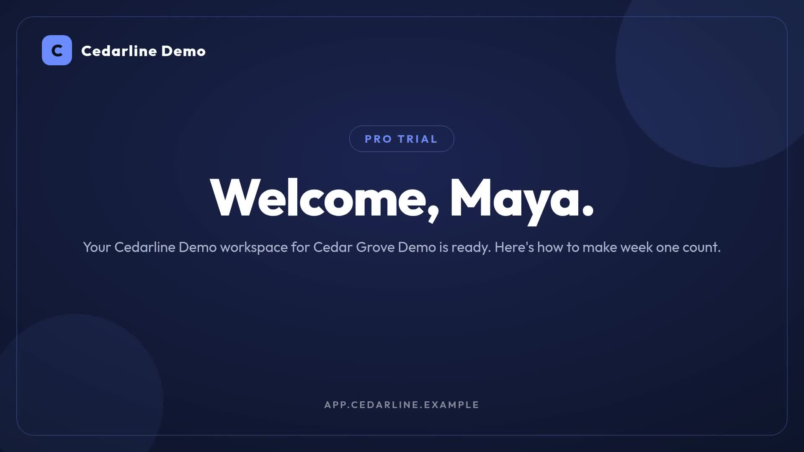

# Personalized welcome video on signup

Turn one signup into a landscape welcome video with their name, company, plan and three onboarding actions. Use the n8n workflow or the Node.js command-line companion. The sample is fictional: Maya at Cedar Grove Demo, using Cedarline Demo.

[](assets/sample-output.mp4)

The example MP4 is 1920 × 1080, approximately 14.57 seconds, with no audio. Its recorded validation estimate was 15 Zvid credits. Validation gives the current estimate for your settings; it is not an audited transaction total.

## Requirements

- Node.js 22 or newer and npm.
- A Zvid account and API key from https://app.zvid.io/api-keys.
- Credits for paid rendering. Offline checks require no API key or credits.

## Install and check

Run these commands from this workflow folder, including when using an extracted standalone ZIP:

```sh
npm ci
npm run check
npm test
```

Copy `.env.example` to `.env`, then enter your complete Zvid API key in `ZVID_API_KEY`. Keep `ZVID_API_URL=https://api.zvid.io`. Never commit `.env`.

## Preview, render and recover

```sh
npm run sample
npm start -- --max-credits 15
npm start -- --resume
```

`npm run sample` validates the current sample and saves an editor draft without submitting a render. Open `editorLink` from `out/result.json` and inspect all three scenes. No render credits are consumed. A draft-storage limit or authentication error can still stop the command.

`npm start -- --max-credits 15` validates and renders once, provided the current quote is no more than 15 credits. `dryRun` defaults to `false` in `config.json`, so plain `npm start` also renders and spends credits. The credit cap is an optional client-side check, not an account spending limit.

Submission intent is saved before the paid request; the accepted job ID is saved to `out/result.json` before polling. The completed MP4 is downloaded to `out/welcome.mp4`. `out/project.json` is the submitted project. The client disables automatic HTTP retries to avoid resubmitting an uncertain paid request.

If polling or downloading stops after an accepted job, run `npm start -- --resume`. This reads the saved job ID and checks/downloads that job without submitting another render. If a network failure occurs before a job ID arrives, the saved state remains `submission-unknown` and blocks another submission from that folder. Inspect your Zvid dashboard before starting again. A lost submission response is not evidence that no job exists. Intentional new videos require another output folder, for example `--out out/maya-v2`.

State files are replaced atomically, and `.run.lock` prevents two processes from using the same output folder at once. If the process is forcibly terminated, confirm it has stopped before manually removing that lock file. Keep `result.json`; its accepted or uncertain state is still needed for recovery.

## Inputs and configuration

`data/signup.json` requires `firstName`; `plan`, `company` and `email` are optional. The CLI also accepts the webhook-shaped `{ "body": { ... } }` object. Names are trimmed and whitespace-collapsed, with maximum lengths of 40 for first name, 48 for plan, 90 for company and 120 for email. These are example rules, not general Zvid restrictions.

`config.json` reproduces the supplied Cedarline Demo sample. Change `brandName`, colors, `cards`, `ctaText`, `ctaUrl` and `supportNote` for your own product. Keep each card short enough to read. `musicUrl` is empty for the sample; a public audio URL adds a background track. The video contains no spoken narration. An on-screen button is visual only; put the actual destination link in your email or application.

```sh
npm start -- --input data/signup.json --config config.json --out out/maya-v2 --max-credits 15
```

Polling uses `pollSeconds` and `timeoutMinutes` from config. The CLI processes one signup per invocation. It does not expose an HTTP endpoint, send email, schedule work or maintain a signup database. Your application must retain a signup-to-job mapping before automating retries or concurrency. Download completed media before its job expiry.

## n8n alternative

See [n8n setup](n8n/README.md). The checked-in export is synchronized with the canonical Zvid workflow. It retains the original Flowdesk sample and `dryRun: false`; use this folder's `config.json` and `data/signup.json` in the matching n8n nodes to reproduce Cedarline Demo. The n8n workflow supports webhook responses and optional SMTP delivery. The CLI keeps those concerns with your application.

The builder is loaded from the trusted checked-in `n8n/workflow.json`, so the two interfaces share the composition logic. The sample project matches the real recorded render exactly; the offline tests cover normalization, escaping, validation failure, credit caps, job persistence, completion and timeout handling. They do not submit paid jobs or send messages.

## Links and support

- [Official n8n template](https://n8n.io/workflows/20075-create-personalized-welcome-videos-for-new-signups-with-zvid-and-smtp/)
- [Zvid integration documentation](https://docs.zvid.io/docs/integrations/)
- [Zvid validation and estimates](https://docs.zvid.io/docs/validate-and-estimate/)
- [General Zvid tutorial video](https://youtu.be/i22Yzjlq9Tg)
- Help: https://zvid.io/contact
