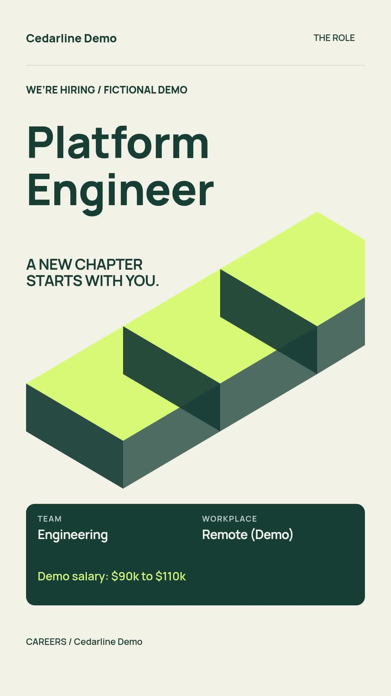

# Hiring videos from approved job postings

Turn one approved job into a 17-second vertical spotlight, or combine up to four approved roles into one roundup. The output includes an MP4, tracked application links, a caption and a recruiter handoff CSV. This example does not evaluate applicants, send messages, or publish posts.

[Watch the retained sample](assets/sample-output.mp4)



The company, role, salary, benefits and application destination are fictional. The supplied sample uses cream, forest green and lime artwork with three scenes: role, benefits and application call to action. It is 1080 × 1920 at 30 fps, lasts 17 seconds and has no audio. Its recorded validation quote was 17 credits, not an audited billing receipt.

## Requirements

- Node.js 22.9 or newer.
- A Zvid API key from https://app.zvid.io/api-keys for remote validation or rendering.
- Enough credits for a paid render. Offline preparation and validation do not submit a render.

The Node.js route accepts a local JSON catalog. Use [the n8n route](n8n/README.md) for Google Sheets and the protected recruiter form. Both use the planner and video designer embedded in the checked-in n8n export.

## Install and inspect the sample

From this folder:

```bash
npm ci
npm run check
npm test
npm run offline
```

On Windows PowerShell, use `npm.cmd` if execution policy blocks `npm.ps1`.

`offline` produces `out/project.json`, `out/plan.json` and `out/handoff-preview.csv`, with no credentials or API calls. It uses 25 October 2026 to reproduce the recorded sample's eligibility. The generated project exactly matches `assets/sample-project.json`.

Copy `.env.example` to `.env`, set `ZVID_API_KEY`, and keep `ZVID_API_URL=https://api.zvid.io`. Then validate without rendering:

```bash
npm run sample
```

The quote and warnings are written to `out/validation.json`. `sample` also uses the recorded sample date. No campaign state is written and no render credits are consumed.

## Render your first campaign

Review `data/jobs.json` and `config.json`. The supplied example has `dryRun: false`, but the script additionally requires an explicit positive command-line credit limit before rendering:

```bash
npm start -- --max-credits 20
```

The effective ceiling is the smaller of `--max-credits` and `maxCreditsPerVideo`. Validation runs before any paid request. Render submission has no automatic retries. The script records submission intent in `out/state.json`, saves the accepted job ID, then polls that job. It downloads the completed video as `out/<CampaignKey>.mp4` and saves `out/<CampaignKey>.csv`.

Paid rendering always uses the current date. The fictional role closes on 15 December 2026, so it is intentionally ineligible after that date. For a real campaign, supply current approved openings and their actual dates. Do not use the demo's example.com application link for a real recruitment post. `--as-of` is allowed only for offline preparation and validation.

Open the MP4 and CSV, check the title, work location, compensation, benefits, application date and every destination, then publish or share manually. A URL in a rendered video is not clickable. Put the corresponding tracked application link in the platform's caption, description or link field.

## Customize

Use `--input path/to/jobs.json --config path/to/config.json --out path/to/state-folder` to select your own files. Paths are relative to the working directory.

Every role needs a unique `JobKey`, approved `Role`, `Approval: "approved"` and an HTTPS `ApplyUrl`. Optional fields are `Team`, `Location`, `SalaryRange`, `Perk1`, `Perk2`, `Perk3`, `OpensOn`, `ClosesOn` and `Priority`. Dates are inclusive in `config.timezone` and must be real YYYY-MM-DD dates. An explicit requested role that is missing, closed or unapproved blocks the entire brief.

In `manualBrief`, set:

- `CampaignKey`: stable identifier using 3–64 letters, numbers, underscores or hyphens. Keep it when recovering the same campaign.
- `Mode`: `spotlight` requires exactly one `JobKeys` value; `roundup` allows comma-separated keys or an empty value to select matching roles.
- `Team` and `Location`: optional exact, case-insensitive filters.
- `MaxRoles`: 1–4; the configured default is 2.

Roundups prioritize the earliest closing date, then higher `Priority`, then `JobKey`. They show one six-second card per role between a three-second introduction and five-second end card. A spotlight shows an extra six-second benefits scene when benefits exist.

`companyName`, `font`, `backgroundColor` and `accentColor` affect the current design. The current hiring designer fixes output at 1080 × 1920 and 30 fps. The inherited `kicker`, `ctaHeadline`, `ctaText`, `resolution` and `frameRate` configuration fields do not override its fixed wording/layout. Edit the checked-in designer if you need those changes and verify it before rendering.

## Recovery and duplicate prevention

```bash
npm start -- --resume
```

Resume reads the saved plan and job ID for the selected `CampaignKey`. It does not submit another paid job, reread changed role facts, or rebuild the design. It can retry a completed download. A polling timeout does not mean the render failed.

If `state.json` says `submission_unknown` and has no job ID, inspect the render in https://app.zvid.io before making another request. The script deliberately refuses to guess. Preserve the state file and job ID for support. A new campaign key is for an intentional new video, not a retry of an uncertain job.

Keep one process per output directory. A local lock file prevents simultaneous processes using that folder; separate folders, computers or n8n runs do not share this protection. The script does not update Google Sheets or refresh Google credentials. Keep private output state out of Git.

## Limits and troubleshooting

- **No eligible role:** check `Approval`, required fields, exact requested keys, dates and filters. Inspect `out/plan.json` for selection reasons.
- **Quote exceeds ceiling:** narrow the campaign or intentionally increase both credit limits after reviewing the quote.
- **Authentication fails:** confirm that the full Zvid key is in `.env`, is active, and targets `https://api.zvid.io`.
- **Wait times out or download fails:** use `--resume` with the same output directory and CampaignKey.
- **Lock remains after a crash:** confirm the earlier process has stopped, then remove only that folder's `.run.lock`.
- **Role details changed:** an existing MP4 is not automatically updated. Review and create a deliberate replacement campaign, then replace outdated posts manually.

Output availability depends on your Zvid plan. Save the MP4 in your own storage before expiry. The sample quote can differ from a customized request; validation returns the current estimate.

See [credits and limits](https://docs.zvid.io/docs/credits-and-plans/), [render recovery](https://docs.zvid.io/docs/operations/render-lifecycle/) and https://zvid.io/contact.
