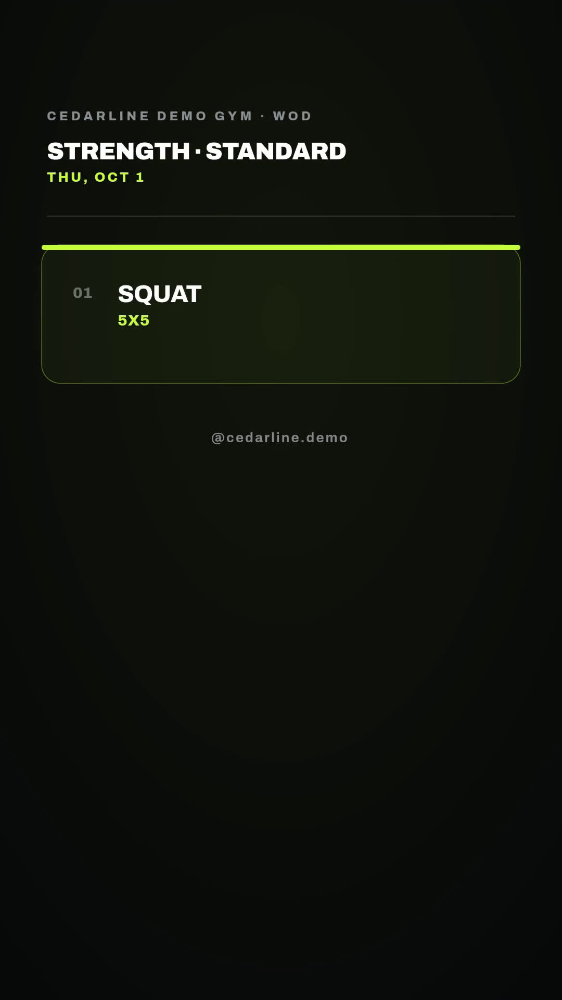

# Standard and scaled workout-of-the-day videos

Turn a coach-supplied dated plan into separate standard and optional scaled vertical videos. Each version gets a caption, saved render ID and video file. The Node.js companion uses the selection rules and video design in the included n8n export, with local JSON input and a persistent local ledger instead of Google Sheets.

[Watch the standard sample](assets/sample-output.mp4) · [Watch the scaled sample](assets/sample-scaled.mp4)



The fictional Cedarline Demo Gym fixture is a software demonstration, not exercise advice or evidence of coach approval. It retains its original 1 October 2026 date: `Squat x 5x5` and `Box squat x 3x8`. A responsible coach must supply and approve real training plans and alternatives. The workflow generates no exercise recommendations.

## Requirements and setup

- Node.js 22.9 or newer.
- A Zvid API key from https://app.zvid.io/api-keys for API validation or rendering.
- Enough credits for a deliberately requested render. Offline checks require no account.

```bash
npm ci
npm run check
npm test
npm run offline
```

The offline command prepares two project JSON files and `out/selection.json`. It makes no API calls and renders no video. Copy `.env.example` to `.env`, then privately enter `ZVID_API_KEY`. Keep `ZVID_API_URL=https://api.zvid.io`.

```bash
npm run sample
npm start -- --max-credits 26
```

`npm run sample` validates each selected design and saves `out/validation.json`. It submits no render and creates no editor draft. The second command renders only if both quotes fit the 26-credit total budget and each fits `config.json`'s `maxCreditsPerVideo` ceiling. The retained samples each received a 13-credit quote, not an audited billing total. Check current quotes; a larger result may exceed this example budget.

`config.json` ships with `dryRun: false`, so the normal start command permits paid rendering. It additionally requires an explicit `--max-credits` argument before any new paid request. The sample configuration sets `fallbackToLatest: true` to reuse the unchanged dated fixture and leaves `musicUrl` empty for silent output. The canonical n8n download defaults to `fallbackToLatest: false` and includes optional music. Both use the same hero footage and three-scene design.

## Inputs and daily use

Edit `data/workouts.json` or provide `--input path/to/workouts.json`. Fields match the sheet columns documented in [n8n/README.md](n8n/README.md). Keep a unique permanent `WorkoutKey`, one row per `Date` in `YYYY-MM-DD`, `WorkoutName`, `Ex1`, and `Approval: "approved"` after coach review. `ScaledEx1` enables the second version. Up to five exercises per version are supported. The last spaced ` x ` or ` × ` separates exercise name from reps.

For a real daily queue, set the correct `timezone` and `fallbackToLatest: false`, add the correct dated row and retain the same output directory between runs. The example's default date reuse is useful for reproducing the sample, but is not an appropriate unattended daily policy. Use `--config path/to/config.json` for a separate production configuration. A scheduler must run one process at a time. No social publishing or Google Sheets reading/writing is implemented in the Node.js route.

After success, open the MP4 files in `out/` and review their matching `.caption.txt` files. `out/state.json` maps each permanent workout key and version to its job ID, quote, state and video URL. Completed versions remain skipped if you keep this ledger. The original input file stays unchanged.

## Recovery

```bash
npm start -- --resume
```

This polls saved accepted jobs and retries missing downloads without submitting another render, even when the plan's date has passed. Keep the same `--out` directory if one was supplied. Failed jobs retain their reason and ID; resuming a failed job reports its status instead of buying a replacement. A submission that disconnects before returning its ID is saved as `submission-unknown` and must be reconciled at https://app.zvid.io before changing state. An explicit 429 rejection is marked `rejected`; wait before a normal retry.

Do not delete the ledger to retry a timeout. To intentionally replace completed media, inspect the previous job first, then remove only that version's confirmed finished ledger entry and source completion fields. A process interrupted while holding `.run.lock` requires checking that no process still runs before removing the stale lock. The lock protects one local output directory, not multiple machines or separate copies.

Download failure preserves the accepted job and URL. Output URLs can expire, so retain downloaded files in your own approved storage. Updating the source data does not update an existing MP4 or a published post.

## n8n

Install **`@zvid/n8n-nodes-zvid`** from **Settings → Community nodes** before configuring credentials. A workspace owner/admin may need to install it. Import `n8n/workflow.json`, keep it inactive during setup, and follow [the full n8n setup](n8n/README.md). Select the same Google Sheets document and tab on the read node and all six update nodes. Select one Zvid API credential on all three Zvid nodes.

The n8n workflow uses Google Sheets completion fields, while this companion uses `out/state.json`. Keep one execution at a time; Google Sheets is not an atomic lock. A successful render plus a failed sheet update needs reconciliation before retrying. The official n8n listing may show an older revision; use the synchronized file supplied here for the standard/scaled tracking behavior.

## Sample evidence and limits

Both 1080 × 1920 silent MP4s are 12.5667 seconds. Their three scenes show a hook, exercise board and coach's note. `assets/sample-project.json`, `assets/sample-scaled-project.json` and `assets/sample-output.json` preserve the public-safe reproduction data. Media URLs in the design use Zvid's CDN. The shared layout has fixed scene timing; it is not an exercise timer or a follow-along training session.

Tests exercise real exported selection/design code and stub only Zvid service boundaries. They cover date fallback, approval, per-version completion, saved-job recovery, quote ceilings, ambiguous submissions, failures and timeouts. They do not perform paid renders or establish live Google Sheets execution.

Support: https://zvid.io/contact
